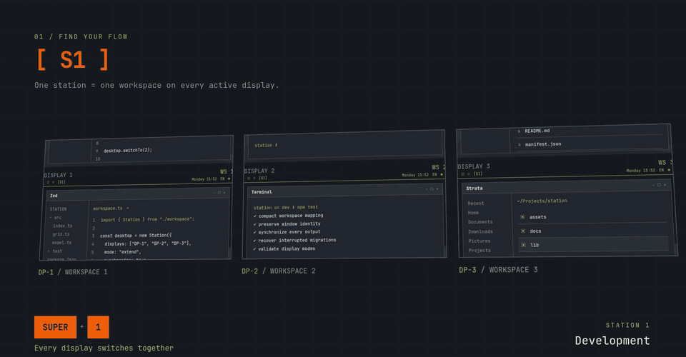
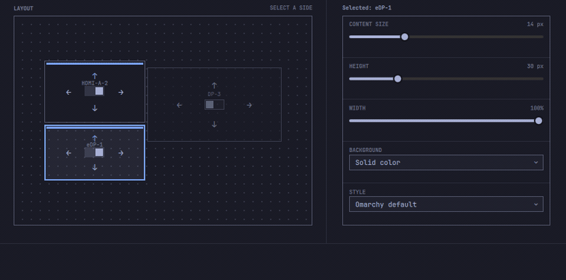
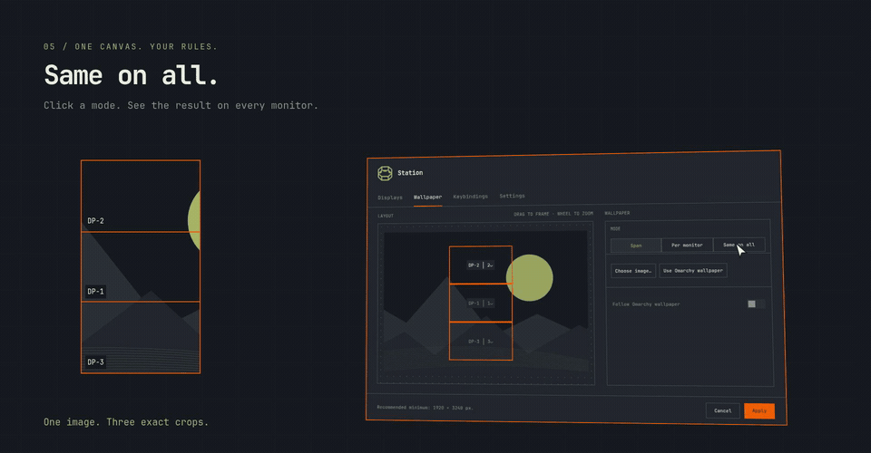

<div align="center">
  
  <h1>Every display. One flow.</h1>
  <p><strong>Synchronized workspaces, display layouts, per-monitor bars, and wallpapers for Omarchy.</strong></p>
  <p>Keep your work together. Make each screen your own.</p>
  <p>
    <a href="https://omarchy.org"></a>
    <a href="manifest.json"></a>
    <a href="LICENSE"></a>
  </p>
  <p>
    <a href="#install">Install</a> ·
    <a href="#stations">Stations</a> ·
    <a href="#displays">Displays</a> ·
    <a href="#bars">Bars</a> ·
    <a href="#wallpapers">Wallpapers</a> ·
    <a href="#keybindings">Keybindings</a>
  </p>
</div>



*One shortcut switches the whole setup. Illustrated feature tour; see the current panel previews below.*

## Meet Station

A **station** is one workspace on each active display. Switch stations and every
screen follows. Send a window to another station and it stays on the same
physical monitor.

With two displays, S1 contains workspaces 1 and 2; S2 contains 3 and 4.
Station manages that numbering for you, including when a display disconnects.

| Your workflow | What Station adds |
| --- | --- |
| **Move between projects** | Synchronized stations, directional navigation, and window moves with or without following. |
| **Change your setup** | A visual display editor with snapping, rotation, Extend/Mirror/Single modes, and guarded previews. |
| **Make room on every screen** | Independent bar placement, visibility, size, background, and Pill style. |
| **Frame your desktop** | The same wallpaper everywhere, one image per monitor, or a single image spanning the layout. |
| **Keep Omarchy familiar** | Native theme styling, familiar shortcuts, global bar-position controls, and drag-to-position. |

## Install

Requires **Omarchy 4 (Quattro)** and **Hyprland 0.56+ with Lua configuration**.
Station manages up to three independent displays.

```bash
omarchy plugin add https://github.com/Yakumy/Station.git --enable
```

Click the Station logo in the bar to open the panel. Station discovers your
displays and enables its workspace shortcuts automatically. No initialization
command or additional dependencies are needed on a standard Omarchy install.

> [!TIP]
> Start with **Displays** to arrange your screens, then visit **Bar** and
> **Wallpaper** to customize the setup. **Keybindings** and **Settings** let you
> adjust how Station fits your workflow.

## Stations

**Keep a whole project one shortcut away.** Use `SUPER + 1…0` to switch every
active display together. The bar’s S1, S2, … indicator shows where you are.

- Move a window to another station and follow it, or send it silently while you keep working.
- Move directionally within a screen, across neighboring displays, and into the next station at the outer edge.
- Choose a station direction that matches your physical layout.
- Disconnect a display without losing each window’s station identity. Station compacts the workspace mapping and expands it when displays return.

The first display retains its role independently of the order in which outputs
are discovered. Station keeps physical identity, display roles, and workspace
numbers separate so changing a layout does not change what a station means.

## Displays


**Arrange your screens where they actually sit.** Drag monitor cards, snap
shared edges, rotate a screen, and choose **Extend**, **Mirror**, or **Single**.
Unequal-height screens can slide along their shared edge instead of being forced
into corner alignment.

Select a monitor to control brightness, scale, resolution, and refresh rate.
Available modes come from that monitor. The text-size control changes text
across Omarchy; display scale changes the apparent size on the selected screen.

Topology edits offer a **12-second Keep/Revert preview**, backed by an independent
20-second recovery watchdog. Station keeps at least one real output enabled and
moves its open panel to a surviving screen when needed. Scale, resolution, and
refresh changes save directly through the checked configuration transaction.

> [!NOTE]
> Station manages at most three independent outputs; additional outputs are
> reported as unmanaged. Three- and four-monitor hardware transitions remain
> unverified on the current two-monitor test setup.

## Bars



*Rendered from the current Bar tab with isolated preview data; no desktop settings were changed for this animation.*

**A different bar for each display, with Omarchy’s controls still available.**
Select a monitor in the **Bar** tab and adjust:

| Control | What it does |
| --- | --- |
| **Presence and position** | Show or hide the bar on a display; choose top, bottom, left, or right with the monitor-card arrows. At least one active display keeps a bar. |
| **Content size** | Enlarge icons and labels together. The live limit reserves padding and prevents the widget groups from overlapping. |
| **Height** | Change bar thickness, up to 5% of the monitor mode’s shorter dimension, subject to Omarchy’s readable minimum. |
| **Width** | Choose how much of the edge the bar occupies. Station keeps enough room for the widgets. |
| **Background** | Choose Solid color, Transparent, or Blur. |
| **Style** | Keep Omarchy’s default bar or use separate Pill groups. The tray pill expands as its drawer opens. |

To move **all bars together**, use Omarchy’s **Bar → Position** menu from
`SUPER + Space`, or drag the bar’s free area toward a screen edge. To position
just one monitor’s bar, use Station’s monitor-card arrows.

The bar keeps Omarchy’s widgets, shared widget layout, and theme colors.
Station’s logo renders as a vector so it stays sharp as content size changes.

## Wallpapers



*Illustrated wallpaper tour. The screenshot below shows the real layout editor.*


**One image across your whole setup—or a different view on every screen.**

| Mode | Use it for |
| --- | --- |
| **Same on all** | Omarchy’s wallpaper or one local image on every display. |
| **Per monitor** | A different local image for each active display. |
| **Span** | One large image across the complete monitor layout. Drag the fixed monitor group to frame it and scroll to zoom. |

Span respects monitor positions, gaps, rotation, logical sizes, and scale. A
recommended source resolution helps you choose an image; smaller images are
still allowed.

**Follow Omarchy wallpaper** is on by default, so theme and background changes
flow through automatically. Turn it off to keep your own images. Station
remembers image choices and Span framing per Omarchy theme/background pair.

Chosen images are prepared as private Station copies. Your originals and
Omarchy’s wallpaper links, theme files, and background history stay intact.

## Keybindings

| Action | Default shortcut |
| --- | --- |
| Switch station | `SUPER + 1…0` |
| Move window to station and follow | `SUPER + SHIFT + 1…0` |
| Send window without following | `SUPER + SHIFT + ALT + 1…0` |
| Previous / next existing station | `CTRL + SUPER + Left / Right` |
| Move across displays and station edges | `SHIFT + CTRL + SUPER + arrows` |

The **Keybindings** tab checks personal conflicts before applying a change.
Choose modifiers, capture the key, then Apply. Conflicting bindings stay inactive
until you choose another combination or explicitly approve replacement.

Station replaces Omarchy’s numbered workspace shortcuts and the grouped-window
focus shortcuts on `CTRL + SUPER + Left/Right`. Disabling or removing Station
restores the defaults and the stock widgets it temporarily hid.

## Make it yours

The **Settings** tab controls follow-focus behavior, station grace delay, minimum
station count, visibility of Omarchy’s Workspace and Display widgets, and whether
the panel opens beside its bar icon or centered on the current monitor.

Colors, typography, spacing, and controls follow the active Omarchy theme.

## Update or remove

```bash
omarchy plugin update yakumy.station
omarchy restart shell
```

To remove Station:

```bash
omarchy plugin remove yakumy.station
```

Preferences and wallpaper copies are retained for a later reinstall. Removal
cleans up Station’s runtime bindings and workspace rules, restores the stock
widgets it leased, and neutralizes its saved Single/Mirror rules. If the shell
was unavailable throughout removal, run `hyprctl reload` once it returns.

<details>
<summary><strong>Where Station keeps its data</strong></summary>

| Data | Location |
| --- | --- |
| Preferences | `~/.config/omarchy/station/config.json` |
| Runtime state and recovery | `~/.local/state/omarchy/station/` |
| Prepared wallpaper copies | `~/.local/state/omarchy/station/wallpapers/` |
| Managed display block | `~/.config/hypr/monitors.lua` |

Station changes only its marked display block, with backup and validation.
Workspace migrations are journaled before moving windows and can resume after
an interruption. It does not edit Omarchy’s packaged files.

</details>

## Development

Read the [specification](docs/v2/SPEC.md), [architecture](docs/ARCHITECTURE.md),
[design system](docs/v2/DESIGN-SYSTEM.md), and
[platform findings](docs/PLATFORM-FINDINGS.md) before changing behavior.
The findings distinguish hardware observations from isolated tests.

<details>
<summary><strong>Verification commands</strong></summary>

```bash
node --test test/m0/*.test.mjs test/v2/*.test.cjs
node tools/v2/check-theme-tokens.mjs
python3 tools/v2/check-layout.py
python3 tools/v2/check-wallpaper-layout.py
omarchy plugin validate .
python3 tools/v2/check-qml.py .
```

The QML check needs Wayland access but does not instantiate Station or change
the desktop configuration. Live topology checks are separate release work.
See [media notes](docs/assets/tours/README.md) for GIF provenance and rendering.

</details>

---

<div align="center">
  <strong>Station is free and open source.</strong><br>
  <a href="LICENSE">Apache License 2.0</a> ·
  <a href="https://github.com/Yakumy/Station/issues">Report an issue</a>
</div>
