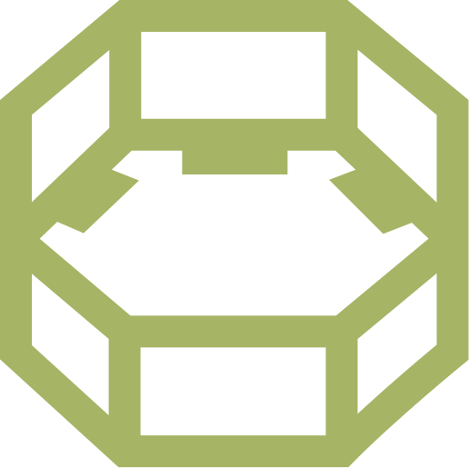
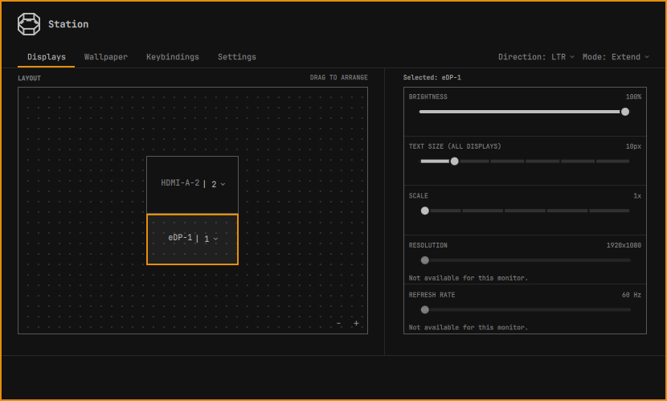
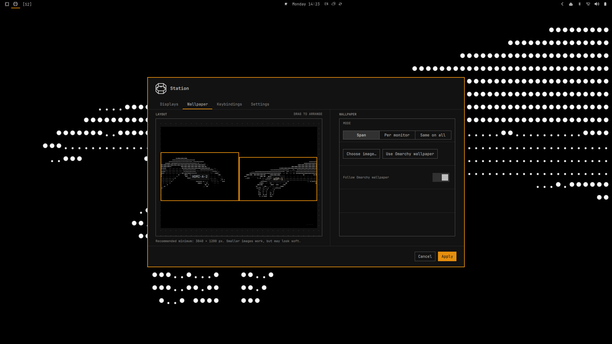

<div align="center">
  
  <h1>Station</h1>
  <p><strong>One workspace system for every monitor.</strong></p>
  <p>
    Station synchronizes Hyprland workspaces, safely manages display layouts,<br>
    and gives Omarchy a proper multi-monitor wallpaper workflow.
  </p>
  <p>
    <a href="https://github.com/Yakumy/Station/stargazers"></a>
    <a href="https://github.com/Yakumy/Station/commits/main"></a>
    <a href="https://omarchy.org"></a>
    <a href="LICENSE"></a>
  </p>
</div>



## Why Station?

Multiple monitors should feel like one desktop, not several unrelated piles of
workspaces. Station groups one workspace from each active display into a
**station** and switches the whole group together.


The compact bar indicator shows the active station at a glance and follows the
current Omarchy theme without competing with the rest of the bar.

With two displays, station 1 contains workspaces 1 and 2, station 2 contains 3
and 4, and so on. Moving a window to another station keeps it on the same
physical display. Disconnect a monitor and the grid compacts without losing the
station each window belongs to; reconnect it and Station expands the grid again.

Station is a native Omarchy 4 plugin. There is no installer script, compiled
binary, background daemon, network service, or initialization command. Enable
the plugin and it is ready.

## Highlights

| | |
| --- | --- |
| **Synchronized workspaces** | Switch every active display together with the familiar `SUPER + 1…0` workflow. |
| **Spatial window movement** | Move naturally within a display, across neighboring displays, and across station edges. |
| **Safe display control** | Arrange, rotate, mirror, disable, scale, and select exact modes with guarded previews and automatic rollback. |
| **Multi-monitor wallpaper** | Use one image everywhere, choose one per monitor, or frame a single image across the complete layout. |
| **Hot-plug recovery** | Preserve station identity while docks and displays appear, disappear, or change roles. |
| **Native Omarchy design** | Uses the installed shell components, theme colors, typography, spacing, and live theme updates. |

## Install

Requirements:

- Omarchy 4 (Quattro)
- Hyprland 0.56 or newer with Lua configuration
- One to three managed independent displays

Install and enable Station with one command:

```bash
omarchy plugin add https://github.com/Yakumy/Station.git --enable
```

Open Station from its bar icon. The panel starts in Extend mode, discovers the
current display arrangement, and activates the synchronized station bindings.
No additional dependencies are required beyond the standard Omarchy system.

> [!NOTE]
> Station manages at most three independent displays. A fourth display remains
> untouched and is reported as unmanaged until you mirror or disable one.

## Displays that fail safely

The Displays tab combines a visual layout editor with per-monitor controls for
brightness, global text size, scale, resolution, and refresh rate. Exact modes
come from the selected monitor rather than being interpolated.

Topology edits—arrangement, rotation, Extend/Mirror/Single mode, and monitor
on/off—open a 12-second Keep/Revert preview. A detached 20-second watchdog
restores the previous layout even if the shell crashes. Station never permits a
zero-output configuration, and it hands an open panel to a surviving display
before disabling the display that owns it.

Scale, resolution, and refresh changes use the same checked file transaction
without an unnecessary preview. Station writes only its marked block at the end
of `~/.config/hypr/monitors.lua`, validates the result through Hyprland, and
restores the backup on failure.

## Wallpaper, built for real monitor layouts



Station supports three wallpaper modes:

- **Same on all** — Omarchy's wallpaper or one local image on every display.
- **Per monitor** — choose a different local image for each active display.
- **Span** — position the complete fixed monitor group over one large image;
  drag to frame it and use the mouse wheel to zoom the crop.

Span respects monitor positions, gaps, rotation, logical size, and scale. The
panel calculates a recommended source resolution for the current layout, while
still allowing smaller images.

**Follow Omarchy wallpaper** is enabled by default. Theme and background changes
then update Station automatically. Turn it off to pin your own images across
theme changes. Station remembers wallpaper choices and Span framing per Omarchy
theme/background pair, so returning to a previous theme restores the view you
used with it.

Chosen files are streamed through a bounded format check before any preview.
PNG text, profile, EXIF, and other non-rendering ancillary chunks are removed,
then only the private Station copy is shown or saved. Older saved choices are
prepared through the same boundary before they can render. Station never
rewrites Omarchy's background link, theme files, or wallpaper history.

## Keybindings

| Action | Default |
| --- | --- |
| Switch station | `SUPER + 1…0` |
| Move window to station and follow | `SUPER + SHIFT + 1…0` |
| Move window to station without following | `SUPER + SHIFT + ALT + 1…0` |
| Previous/next existing station | `CTRL + SUPER + Left/Right` |
| Move across displays and station edges | `SHIFT + CTRL + SUPER + arrows` |

Directional movement tries normal Hyprland movement first, then a neighboring
display, then an adjacent station at the outer edge. The Keybindings tab shows
personal conflicts before applying them. A conflicting binding remains inactive
until you choose another combination or explicitly approve replacement.
Choose modifiers with the chips, then click the key button and press the key
alone. The Special key menu includes Escape and Tab; Escape cancels capture.
Apply saves the combination, while Cancel discards the edit. The picker does
not read the clipboard.

Station intentionally replaces Omarchy's numbered workspace bindings and the
rarely used grouped-window focus bindings on `CTRL + SUPER + Left/Right`. It
records the stock workspace widget before hiding it and restores the widget and
default bindings when Station is disabled or removed.

## Settings and state

Settings include follow-focus behavior, the station grace delay, minimum station
count, whether to show Omarchy's Workspace and Display widgets, and whether the
panel opens beside the bar icon or centered on the current monitor.

| Data | Location |
| --- | --- |
| Preferences | `~/.config/omarchy/station/config.json` |
| Runtime state and recovery | `~/.local/state/omarchy/station/` |
| Saved wallpaper copies | `~/.local/state/omarchy/station/wallpapers/` |
| Managed display block | `~/.config/hypr/monitors.lua` |

Station journals workspace migrations before moving windows and resumes an
interrupted migration by saved window identity and station. Disabling or removing
the plugin restores only the stock widgets Station leased, removes runtime
bindings and workspace rules, and neutralizes saved Single/Mirror rules.

## Update or remove

```bash
omarchy plugin update yakumy.station
```

If an updated panel is still cached, refresh the shell once:

```bash
omarchy restart shell
```

Remove Station through Omarchy:

```bash
omarchy plugin remove yakumy.station
```

Saved preferences and wallpaper copies are retained so a later reinstall can
recover them. If the shell was unavailable for the entire removal cleanup window,
run `hyprctl reload` once it returns.

## Development

Station's behavior, transaction guarantees, and verified platform findings are
documented in [the v2 specification](docs/v2/SPEC.md),
[architecture guide](docs/ARCHITECTURE.md), and
[platform findings](docs/PLATFORM-FINDINGS.md). UI work follows the
[Station design system](docs/v2/DESIGN-SYSTEM.md).

Run the standard checks from the repository root:

```bash
node --test test/m0/*.test.mjs test/v2/*.test.cjs
node tools/v2/check-theme-tokens.mjs
python3 tools/v2/check-layout.py
python3 tools/v2/check-wallpaper-layout.py
omarchy plugin validate .
python3 tools/v2/check-qml.py .
```

`check-qml.py` needs access to the live Wayland session but does not instantiate
Station or change the desktop configuration. Hardware topology changes remain
manual release checks; the offscreen tests do not pretend to prove real hardware.

## License

Station is available under the [Apache License 2.0](LICENSE).
