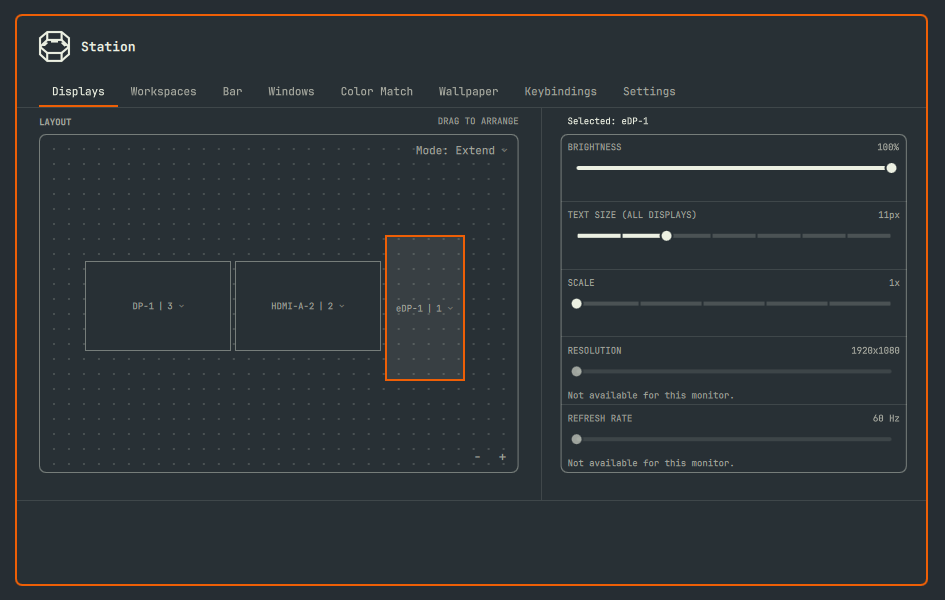
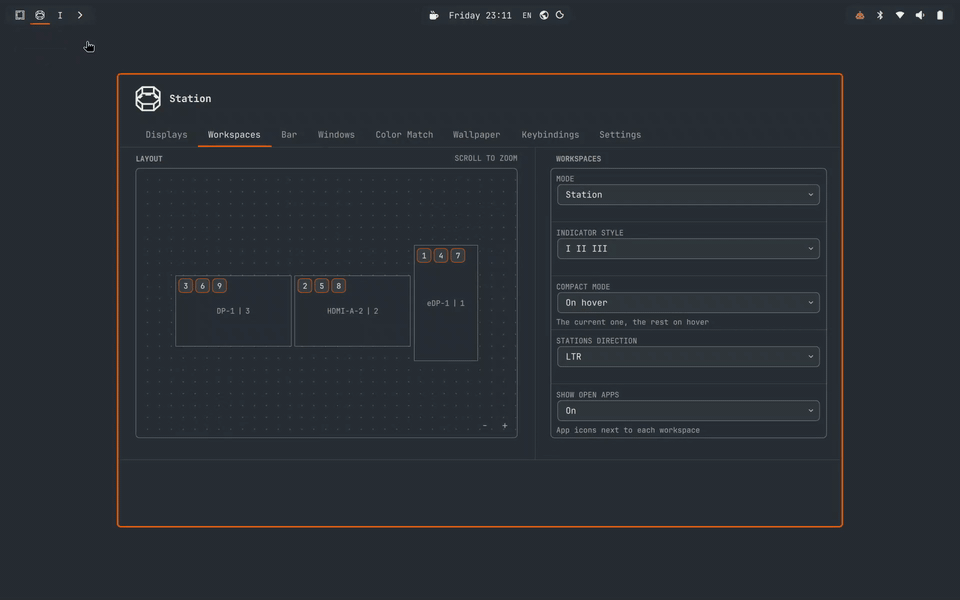
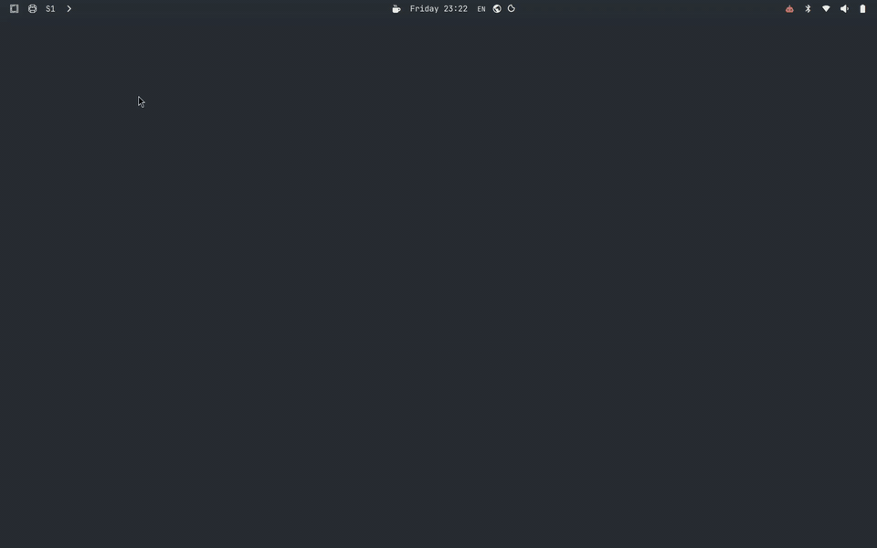
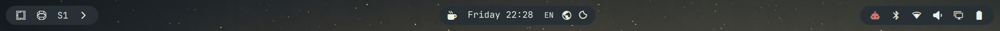
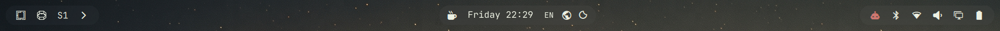
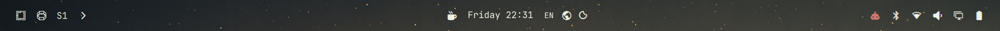
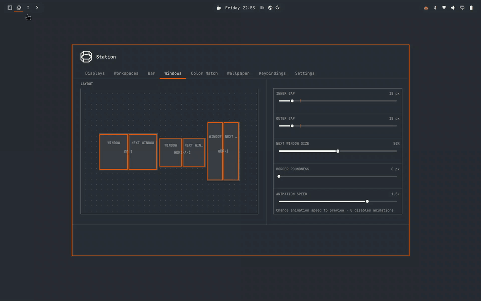
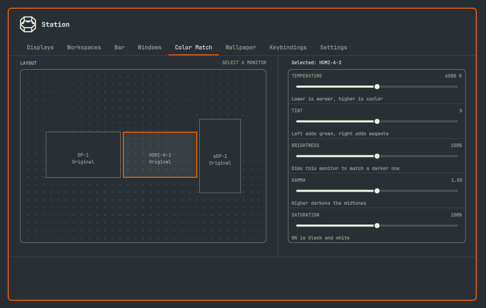
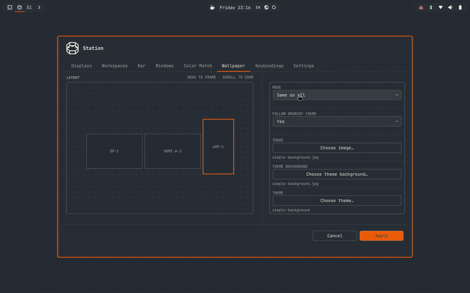

<div align="center">
  
  <h1>All Displays, One flow.</h1>
  <p>
    <a href="https://omarchy.org"></a>
    <a href="manifest.json"></a>
    <a href="LICENSE"></a>
    <a href="https://github.com/Yakumy/Station/stargazers"></a>
  </p>
  <p>
    <a href="#install-update-uninstall">Install</a> ·
    <a href="#displays">Displays</a> ·
    <a href="#station--workspaces">Workspaces</a> ·
    <a href="#bars">Bars</a> ·
    <a href="#windows">Windows</a> ·
    <a href="#color-match">Color Match</a> ·
    <a href="#wallpapers">Wallpapers</a> ·
    <a href="#keybindings">Keybindings</a>
  </p>
</div>

---

## Meet Station

Station is a multi-monitor manager for Omarchy. It helps you arrange your monitor
layout, manage how workspaces are assigned, place and customize each monitor's bar,
and set one wallpaper across all of your monitors. When you use a multi-monitor setup,
you are "Stationary", right? That's where the name Station comes from.

---

## Install, Update, Uninstall

To install Station:

```bash
omarchy plugin add https://github.com/Yakumy/Station.git --enable
```

To update Station:

```bash
omarchy plugin update yakumy.station
omarchy restart shell
```

To remove Station:

```bash
omarchy plugin remove yakumy.station
```

---

## Startup

Click the Station logo in the bar to open the panel. Station finds your displays and
enables its shortcuts on its own. There is nothing else to install or set up.

Start with **Displays** to arrange your screens, then **Workspaces** to choose how
workspaces are assigned. **Bar**, **Windows**, **Color Match** and **Wallpaper**
customize the look. **Keybindings** lets you change any shortcut.

---

## Displays



Drag monitors to where they sit on your desk, rotate a screen, and choose **Extend**,
**Mirror** or **Single**. Select a monitor to set its brightness, scale, resolution
and refresh rate. Text size changes text across Omarchy.

Layout changes open a 12-second **Keep / Revert** preview, so a wrong layout puts
itself back.

---

## Station & Workspaces



This tab is the core of Station. Decide how your workspaces are assigned, how many
you need on each monitor, and how the bar shows them. The layout updates as you
change the controls. Changes wait for **Apply**, and **Cancel** undoes them.

---

## Modes

Choose how workspaces are numbered in the Workspaces tab:

| Mode | How it works |
| --- | --- |
| **Station** | Every monitor switches together. `SUPER + 1` shows Station 1 on all screens. |
| **Repetitive** | Every monitor numbers its own workspaces from 1, as Omarchy 4.5 does. |
| **Non-repetitive** | Each number belongs to one monitor, as in Omarchy 4.0. |

---

## Workspaces

Use **−** and **+** on a monitor in the layout to change its workspaces, up to 10 per
monitor. In Non-repetitive, drag a workspace number onto the monitor you want.

Pick the bar indicator style (S1 S2 S3, 1 2 3 or I II III), a compact mode (Off,
On hover or On), and whether open apps show next to each workspace.

---

## Directions

**Stations Direction** matches station navigation to your physical layout: LTR, RTL,
TTB or BTT. `CTRL + SUPER + arrows` move to the next or previous station in that
direction. It works in Station mode.

---

## Bars



Every monitor gets its own bar. Select a monitor to show or hide its bar, move it to
any edge with the arrows, and set its content size, height, width, background and
style. You can also drag a bar's free area toward another edge.

**Background:** Solid color, Transparent or Blur. **Style:** Omarchy's default bar or
separate Pills.







---

## Windows



Tune inner and outer gaps, the next window's size, border roundness and animation
speed. Sample windows on your layout show the result while you drag. Release to apply.
Speed 0 turns animations off.

---

## Color Match



Give every monitor the look you want, from a warm, film-like tone to cool and crisp,
or simply make all your screens show the same white. Select a monitor and adjust its
temperature, tint, brightness, gamma and saturation. Each change applies when you
release the slider, and the settings follow the monitor to another port.

No digging through your monitor's buttons and on-screen menus. Station does it all
from your desktop.

---

## Wallpapers



| Mode | Use it for |
| --- | --- |
| **Span** | One large image across all your monitors. Drag to frame it, scroll to zoom. |
| **Per monitor** | A different image on each monitor. |
| **Same on all** | One image on every monitor, framed separately on each. |

**Follow Omarchy theme** keeps your wallpaper in step with theme changes. Your
original images and Omarchy's files are never changed.

---

## Keybindings

| Action | Default shortcut |
| --- | --- |
| Switch station | `SUPER + 1…0` |
| Move window to station and follow | `SUPER + SHIFT + 1…0` |
| Move window without following | `SUPER + SHIFT + ALT + 1…0` |
| Previous / next station | `CTRL + SUPER + arrows` |
| Move across monitors and stations | `SUPER + SHIFT + CTRL + arrows` |

Change any shortcut in the **Keybindings** tab. Station checks for conflicts before
it applies a change. Removing Station restores Omarchy's default shortcuts.

---

## Development

Start with the [documentation index](docs/README.md). [AGENTS.md](AGENTS.md) lists the
rules for changing Station.

```bash
python3 test/run.py        # portable checks
python3 test/run.py all    # everything, needs a Wayland session
```

Station is free and open source under the [Apache License 2.0](LICENSE).
