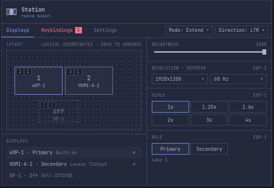

# Station

Station makes up to three Hyprland displays behave as one workspace system. A
station contains one workspace per active managed display. With two displays,
station 1 uses workspaces 1–2, station 2 uses 3–4, and so on. With one display,
station numbers and workspace numbers are identical. Switching a station changes every display
together. Sending a window to another station keeps it on the same physical
display.

Station v2 is a pure Omarchy 4 plugin. It has no installer, binary, standalone
CLI, network access, or initialization step. Enabling the plugin starts it.



## Requirements

- Omarchy 4 (Quattro)
- Hyprland 0.56 or newer with Lua configuration
- One to three managed displays; a fourth display stays unmanaged until you
  mirror or disable it

## Install

```bash
omarchy plugin add https://github.com/Yakumy/Station.git --enable
```

Station immediately replaces Omarchy's numbered workspace bindings and the
rarely used grouped-window focus bindings on `CTRL + SUPER + Left/Right`. It
records and hides Omarchy's workspace bar widget, then restores the widget and
default bindings when Station is disabled or removed.

## Keybindings

| Action | Default |
| --- | --- |
| Switch station | `SUPER + 1…0` |
| Move window to station and follow | `SUPER + SHIFT + 1…0` |
| Move window without following | `SUPER + SHIFT + ALT + 1…0` |
| Previous/next existing station | `CTRL + SUPER + Left/Right` |
| Move across displays and station edges | `SHIFT + CTRL + SUPER + arrows` |

Arrow movement follows v1's sequence: try normal Hyprland window movement first,
then a neighboring display, then an adjacent station at the outer edge. A tiled
window may therefore move within the current display before crossing it. Station
crossings synchronize all displays and restore focus to the moved window. With
vertically stacked displays, Left/Right station crossings keep the same display;
with horizontally arranged displays, they enter the opposite edge. Single mode
also allows station crossing after native movement reaches an edge.

Bindings use direct Lua `hl.bind`/`hl.dsp.exec_cmd` dispatchers. The v2 service
registers them at activation and after Hyprland reloads, calling its IPC endpoint.
It does not require the v1 `station-bindings.lua` include or a Station binary.

The Keybindings tab identifies personal conflicts before applying them. A
conflicting binding stays inactive until you choose another combination or
explicitly approve **Replace and unbind it**.

## Displays

Open Station from the bar to arrange displays, choose Extend, Mirror, or Single
mode, adjust brightness, select an exact resolution and refresh mode, set scale
and rotation, or swap display roles. Layout changes start as a preview. Choose
**Keep** within 12 seconds or Station restores the previous runtime layout. A
detached 20-second watchdog also restores it if the shell crashes.

Kept layouts are written as a marked block at the end of
`~/.config/hypr/monitors.lua`. Station backs up the file, writes atomically,
reloads Hyprland, checks `hyprctl configerrors`, and restores the backup if the
new configuration fails. Settings can remove the managed block entirely.

## State and removal

Station stores preferences in `~/.config/omarchy/station/config.json` and
runtime bookkeeping in `~/.local/state/omarchy/station/state.json`. The saved
workspace mapping and recoverable migration journal live beside it in
`workspace-map.json`.

When displays change, windows keep their station and stay on surviving physical
displays. Windows from a removed display merge into a survivor in the same
station. Workspace numbers compact or expand; a returning display starts with
empty workspaces. For example, single-display workspace 3 becomes workspace 5
on the original display when extending to two displays. Explicit Single and
Mirror modes use one workspace per station. Preview does not renumber windows;
Keep commits the mode and then migrates them.

```bash
omarchy plugin update yakumy.station
omarchy restart shell

omarchy plugin remove yakumy.station
```

Removal restores the stock workspace widget, neutralizes any saved Single or
Mirror rule to plain display geometry, and reloads Hyprland so Station bindings
and workspace rules do not linger. If the shell is unavailable throughout the
cleanup window, run `hyprctl reload` once it returns.

## Development

```bash
node --test test/m0/*.test.mjs test/v2/*.test.cjs
node tools/v2/check-theme-tokens.mjs
omarchy plugin validate .
python3 tools/v2/check-qml.py .
```

The implementation contract and hardware evidence are in
[`docs/v2/SPEC.md`](docs/v2/SPEC.md) and [`docs/v2/M0.md`](docs/v2/M0.md).
