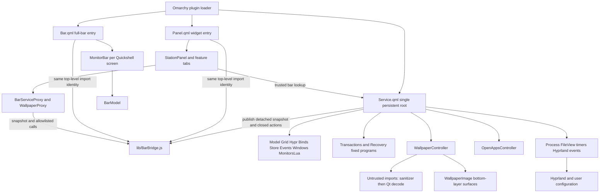
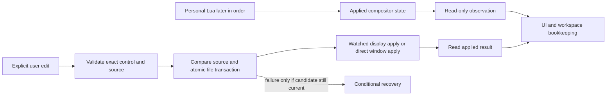
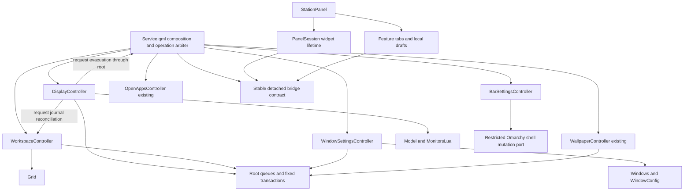

# Station architecture audit and refactoring proposal

Status: approved direction, implementation in progress. See
[the implementation checkpoint](ARCHITECTURE-REFACTOR-STATUS.md). Audited on
2026-11-05 at `d9caad9cf0ccc0ceb2bbe6a0f965e4f3aaa5c0d2` (`dev`, manifest
3.0.0). The starting worktree was clean. Evidence locations refer to that revision;
line numbers will move during implementation. Repository-relative links are used
so this proposal remains useful outside the author's machine.

Review revision: the user approved the general direction subject to the gates
below. This revision adds safe compilation/package baselines, mandatory human
review before M5/M6, a reproducible hardware procedure, conditional M2 deletion,
and optional M8/M9. The user subsequently authorized implementation and one
commit per completed step on `dev`, without pushing. M5/M6 retain their explicit
human-review gates. M2 deletion remains conditional on its compatibility proof.
The checkpoint records completed steps and remaining limits.

## 1. Executive summary

Station already has the right fundamental architecture for its platform: one
persistent QML service, pure JavaScript policy, native Omarchy UI, checked file
transactions, and detached recovery. Retain it. A web-style global store, generic
message bus, dependency-injection framework, extra daemon, or Node runtime would
add complexity without resolving the observed problems.

The largest architectural risk is that several asynchronous protocols share one
mutable namespace in `Service.qml`. The tests reproduce that namespace to exercise
production functions. The panel similarly combines host lifecycle management with
feature editors. This makes changes depend on temporal knowledge across functions,
FileView signals, timers, and visual-object destruction. File size is supporting
context, not the reason to extract code.

There are also concrete consumer-contract mismatches: wallpaper image selection is
missing from the bridge/proxy path, key capture uses the wrong tab index, and the
wallpaper chooser returns to the wrong remembered tab. These are source-confirmed
inconsistencies, not live reproductions. Resolve them in separately reviewed fixes
with regression coverage before preserving behavior in structural refactors.

Recommended sequence:

1. Strengthen consumer-contract and QML discovery coverage; characterize the three
   inconsistencies before fixing them in separate changes.
2. Consider deleting the obsolete production geometry-copy save dependency only
   after cross-version and detached-recovery compatibility is demonstrated (§13,
   M2); otherwise retain it.
3. Establish narrow bar-settings and window-settings owners, then a durable
   workspace-migration owner and a display-edit owner.
4. Separate panel lifecycle from feature editing; retain the single persistent
   service and the same direct/bridge entry paths.
5. Optionally move files or deepen the adapted bar after interfaces stabilize,
   only where measured maintainability gains justify the change. M8 and M9 can
   both be skipped without making the preceding refactor incomplete.

These are multiple small milestones, not one rewrite. The highest-risk display
and migration extractions require stronger behavioral harnesses first. Directory
cleanup and speculative performance work come last.

## 2. Scope, method, and evidence limits

The audit used the installed `assessment`, `improve-codebase-architecture`,
`architecture-deepening`, and `omarchy` skills. The second was found at
`~/.agents/skills/improve-codebase-architecture/SKILL.md`. The architecture skill's
fresh-context exploration was used for independent service, UI, and test/tool
reviews. Recommendations apply the deletion test: which caller responsibilities
actually disappear behind an interface? No candidate is justified by line count
alone.

The user's explicit deliverable overrides skill defaults for a temporary HTML
report, interactive candidate selection, ADR/JSON persistence, glossary edits, and
successor-workflow dispatch. The audit created no implementation, ADR registration, skill handoff,
or additional repository document. Implementation status is now tracked separately. Skill terminology is adapted to
QML: a persistent child object is an internal owner, not another plugin service.
The Omarchy skill is primarily for installed desktop customization; its read-only
platform guidance is applicable here, but its blanket reload recommendation is
superseded by Station's accepted direct-save and watched-apply contracts.

Inspection covered all 133 tracked paths recursively: root runtime and packaging,
all `lib/` runtime files, every test and helper, tools including historical M0
fixtures, workflow, documentation, notices, and asset inventory. Binary media was
inventoried with its documented provenance, not treated as executable code or
subjected to visual/artwork review. Ignored dependencies, Git internals, private
credentials, and historical branches were not audited as current application code.
Read-only history inspection included the last 50 commits; `Service.qml` appears
in 18 of them. Recent fixes to authority, internal-monitor Keep, and window saves
are evidence that these protocols change together, not evidence that they fail.

Primary authorities read: [AGENTS](../AGENTS.md), [architecture](ARCHITECTURE.md),
[README](../README.md), [v2 specification](v2/SPEC.md),
[v3 authority revision](v3/SYSTEM-AUTHORITY.md),
[platform findings](PLATFORM-FINDINGS.md), [design system](v2/DESIGN-SYSTEM.md),
[wallpaper contract](v2/WALLPAPER.md), [CI](CI.md), [test results](TEST-RESULTS.md),
and M0/cold-login evidence. Historical replay and EOF-precedence descriptions are
explicitly superseded by v3, not recommendations to restore old behavior.

Installed source was inspected read-only under `/usr/share/omarchy/shell/`:
`services/PluginRegistry.qml`, `services/PluginRegistryApi.qml`,
`plugins/bar/Bar.qml`, and `Ui/KeyboardPanel.qml`. The bar's
`pluginBarApiFor` implementation explicitly distinguishes service-capable trusted
widgets from service-less replacement-bar facades. KeyboardPanel requires both an
anchor and bar, derives its screen from the anchor window, and separates keyboard
focus from fade-out visibility. These substantiate keeping Station's native host
integration. No installed files were changed.

Fingerprint caveat: `/usr/share/omarchy/version` currently contains
`4.0.0.alpha`; Station's documented adapted-bar baseline is Omarchy 4.0.6. That
version-file discrepancy does not establish a runtime incompatibility. This audit
did not requalify the full running stack or claim parity with current upstream.
Future integration work must record actual package/source hashes and compositor,
Qt, and Quickshell versions before using old live findings as release evidence.

### Verification performed during this audit

| Check | Actual result | Meaning |
| --- | --- | --- |
| `node --test test/m0/*.test.mjs test/v2/*.test.cjs` | Unrestricted rerun: 243 tests passed, 0 failed, 0 skipped; about 7.1 seconds | Existing portable and installed-source contracts passed in this environment |
| Initial sandbox Node run | Three Lua-dependent test files failed with timeout-like results; successful rerun above | Environment-sensitive subprocess execution; not diagnosed as an application failure |
| `node tools/v2/check-theme-tokens.mjs` | 43 files scanned, 0 violations | Current configured scan surface only; see missing root entry coverage below |
| QML compilation and plugin validation | Not run in the initial audit; verified in the proposal-review follow-up below | Compile/package baseline only |
| Pointer harnesses | Not run during this audit or follow-up | No new interaction/rendering claim |
| Live monitor, wallpaper, config, restart, cleanup experiments | Not run | No new hardware or live-lifecycle claim |

Node output is retained at `/tmp/station-audit-node-tests-unrestricted.log` as
session evidence; durable conclusions are recorded here because `/tmp` is not a
long-term archive. Final proposal whitespace and worktree checks are recorded in
§15. No dependencies were installed.

### Verified safe baseline added during proposal review

The source remained at `d9caad9cf0ccc0ceb2bbe6a0f965e4f3aaa5c0d2` while these
checks ran. They did not install/enable Station, instantiate its production
entry objects, restart the desktop shell, or modify desktop configuration.

| Check actually executed | Result | Exact coverage / limitation |
| --- | --- | --- |
| `python3 tools/v2/check-qml.py .` | Exit 0; `STATION_COMPONENTS_READY`; no compile-failure marker | Panel, Service and 22 flat `lib/*.qml` components: 24 total. The current tool still omits Bar |
| Temporary copy of that probe with `Bar.qml` added to `component_names` | Exit 0; `STATION_COMPONENTS_READY`; `ALL_ENTRY_COMPILE_EXIT=0` | All three root entries plus 22 library QML components: 25 total. Repository tool/source unchanged; this does not implement M0 recursive discovery |
| `omarchy plugin validate` on a clean `git archive` export of the exact SHA above | Exit 0; `PLUGIN_VALIDATE_EXIT=0` | Committed package manifest, declared entry points and symlink policy; excludes ignored developer files and this uncommitted proposal |

The temporary all-entry probe initially refused sandboxed Wayland socket access;
the approved session-access rerun passed. Both successful compile runs emitted a
Qt host-portal registration warning, but no component compile failures. This
warning is recorded rather than treated as runtime/UI qualification. The probes
instantiate only their temporary compile harness; `Qt.createComponent` loads
production component definitions without creating Station's Service/Panel/Bar.
Quickshell may write its normal per-probe runtime logs. Plugin validation is
static folder validation, not execution or marketplace approval.

Reproduction from the repository root, with session access for compilation:

```sh
python3 tools/v2/check-qml.py .
```

The supplemental all-entry and clean-export checks used this temporary-only
procedure. It is documentation of the baseline, not an M0 code change:

```python
from pathlib import Path
import subprocess
import tempfile

checkout = Path.cwd()
source = (checkout / "tools/v2/check-qml.py").read_text()
needle = 'component_names = ["Panel.qml", "Service.qml"]'
assert source.count(needle) == 1  # Stop if the probe has changed.
with tempfile.TemporaryDirectory(prefix="station-baseline-") as folder:
    probe = Path(folder) / "check-all.py"
    probe.write_text(source.replace(
        needle, 'component_names = ["Panel.qml", "Service.qml", "Bar.qml"]'))
    subprocess.run(["python3", str(probe), str(checkout)], check=True)
    archive = Path(folder) / "source.tar"
    export = Path(folder) / "source"
    export.mkdir()
    revision = "d9caad9cf0ccc0ceb2bbe6a0f965e4f3aaa5c0d2"
    subprocess.run(["git", "archive", "--format=tar",
                    "--output=" + str(archive), revision], check=True)
    subprocess.run(["tar", "-xf", str(archive), "-C", str(export)], check=True)
    subprocess.run(["omarchy", "plugin", "validate", str(export)], check=True)
```

For a future baseline substitute the reviewed source SHA and record it with the
commands, outputs, host-source hashes and stack fingerprint. If Wayland, installed
host modules or the validator are unavailable, report the check as blocked or
skipped with its reason; never replace it with a claimed pass. Compilation does
not establish bindings, interaction, evacuation or hardware recovery. M0 still
needs permanent discovery completeness tests and its own authorization.

## 3. Current architecture and repository structure

This is a source-distributed Quickshell plugin. There is no root application build
system, npm dependency graph, or bundler. Node is a test tool; runtime JS uses QML
script imports with conditional CommonJS exports for isolated tests. Most policy
scripts have no imports of one another; QML currently performs their composition.

```text
station/
├── Service.qml                 persistent behavior, IPC, orchestration
├── Panel.qml                   stable top-level widget/bridge entry
├── Bar.qml                     full-bar entry and per-screen host fan-out
├── manifest.json               bar + bar-widget + service kinds
├── lib/                        41 runtime files; inventory in §5
├── test/
│   ├── m0/                     installed-source and theme contracts
│   └── v2/                     portable regression tests + helpers/monitor-lua.cjs
├── tools/
│   ├── v2/                     compiler, token, pointer/render probes, M0 fixtures
│   └── v3/check-window-sliders.py
├── docs/
│   ├── ARCHITECTURE.md, PLATFORM-FINDINGS.md, TEST-RESULTS.md, CI.md
│   ├── BRANDING.md, assets/     media and provenance
│   ├── v2/                     specification, design, wallpaper, M0/cold evidence
│   └── v3/SYSTEM-AUTHORITY.md   accepted authority revision
├── assets/                     two SVG logo assets
├── .github/workflows/checks.yml
└── README.md, AGENTS.md, CHANGELOG.md, LICENSE, THIRD_PARTY_NOTICES.md,
    preview.png, .gitignore, .gitattributes
```

`Service.qml` is 2,804 lines, `MonitorBar.qml` 2,455, `StationPanel.qml` 882,
`Model.js` 444. Shell templates make physical line counts misleading:
`Recovery.js` is five lines containing a substantial escaped program. Analyze
those programs by operations and exit paths, not by apparent size.

### Authority and lifecycle

| Data | Authority / owner | Persistence and synchronization |
| --- | --- | --- |
| Effective monitor layout and global window settings | Hyprland | Observed; cached values never enforce old settings on startup/reload/hotplug |
| Identity and preferred lanes, station preferences | Station service | `config.json`, Store migrations; identity/lane/slot/role remain distinct |
| Committed workspace map and pending move journal | Service migration protocol | `workspace-map.json`; save acknowledgments gate moves and map exposure |
| Selected station, owned bindings, stock-widget leases | Service | `state.json`; runtime ownership survives ordinary widget rebuilding |
| Display draft and preview baseline | Service | Transient editing session plus durable journal/token; original client identity retained |
| Bar rows | Omarchy configuration, with explicit Station edits staged locally | Changed host rows supersede pending local row writes; mirror write deferred while panel open |
| Panel wanted/output/tab/selection | Persistent service memory | Not restored as an open panel after full shell restart |
| Visual panel geometry, key draft, local slider interaction | Widget/panel | Destroyed/rebuilt with bar/output; durable intent must stay outside it |
| Open-app rows | Read-only OpenAppsController feed | Derived independently from migration snapshots; journal-aware grouping |
| Wallpaper | Omarchy in Follow mode, explicit Station choice otherwise | Controller owns draft/import/save; private staged copies retained |
| Global blur | Hyprland | Station owns its bar layer rule only |

`gen` identifies Station operations; `configGeneration` identifies compositor
configuration generations. They are different cancellation domains. `runNext`
checks the latter before executing queued generation-tagged commands; it cannot
cancel an already running compositor command. `refresh` has a separate serialized
snapshot queue so a later request does not overwrite a migration callback.

## 4. Dependency and data-flow diagrams

Arrows below mean dependency or directed communication, not ownership transfer.
The bridge passes detached data and explicit callable actions, never the service
QObject. Internal callbacks remain inside the persistent service lifetime.



```mermaid
sequenceDiagram
  participant U as Display action
  participant S as Persistent service
  participant P as Panel surface
  participant H as Hyprland
  participant J as workspace-map.json
  participant W as Detached watchdog
  U->>S: Validated edit / preview
  S->>W: Arm or refresh preview token
  S->>P: Request evacuation with serial and output
  P-->>S: Acknowledge after hidden/unmapped barrier
  S->>H: Enable/focus survivor before disabling or mirroring
  Note over S,H: Expected events recorded before dispatch
  S->>H: Apply validated preview topology
  S->>J: Write original identities and pending destinations
  J-->>S: Saved acknowledgment
  S->>H: Rules, moves, destination placement
  S->>H: Read and verify destinations even after aggregate errors
  S->>J: Write verified mapping commit
  J-->>S: Saved acknowledgment
  S-->>U: Stable preview with Keep/Revert countdown
  Note over S,W: Keep disarms only after checked persistence; timeout/restart retains recovery
```

This diagram shows protocol barriers, not a universal literal ordering for every
mode transition. `continuePreviewApply` has a migrate-first branch; source/sink
changes and Revert have different survivor sequences. Preserve those branches
and compare traces individually rather than replacing them with this illustration.



## 5. Module responsibility inventory

All paths in this table are current paths. Grouped rows enumerate every file in
`lib/`; a group does not imply those files should be merged.

| Files | Responsibilities and dependencies | Assessment |
| --- | --- | --- |
| `Service.qml` | Bootstrap, IPC, generation/operation arbitration, command/snapshot queues, binds, topology, display drafts and save, migration, bars, leases, window settings, panel intent, cleanup; imports most policy scripts and two controllers | Correct persistent owner; too many private protocols in one namespace |
| `Panel.qml` | Imports bridge beside service; instantiates StationPanel and injects reader | Keep stable and small |
| `Bar.qml` | Per-screen MonitorBar creation, peer popout closure, bridge snapshots, focused bar facade, validated fallbacks and size reporting | Keep entry and multi-screen coordination separate from per-screen rendering |
| `lib/Grid.js` | Compact mapping, eligibility, client identity, plan/resume/preview restoration, existing stations | Strong pure contract; do not merge with current-topology observation |
| `lib/Model.js` | Identity, lane assignment, logical geometry, snapping/attachment, mode choices, directional navigation, observed options | Broad but related pure policies; naming risk, not proof that four smaller files improve locality |
| `lib/Hypr.js` | Connector/address/workspace checks and Lua generators for workspace/window dispatches | Keep validation at generation boundary; not the owner of all process execution |
| `lib/Binds.js` | Action definitions, key normalization/aliases, conflict parsing, approved/stock replacement policy, Lua generation | Good pure boundary; Omarchy menu remains conflict identity source |
| `lib/Events.js` | Monitor event output parsing and bounded expected-event matching | Small meaningful security/lifecycle predicate; size does not justify merging |
| `lib/MonitorsLua.js` | Layout validation, marker parsing, guarded managed block, geometry/plain copy, removal/migration, internal-toggle recognition | Keep opaque personal Lua and cold-presence guard; see obsolete plain-copy consumer |
| `lib/Store.js` | Config version 9/state version 4 defaults and normalization, legacy flags, bars normalization | Pure codecs, not disk I/O; preserve unknown compatible fields and existing migrations |
| `lib/Transactions.js` | Display Keep/watchdog, precedence migration, direct window-setting shell templates | Distinct protocols; do not unify under one generic save/reload algorithm |
| `lib/Recovery.js` | Detached restart-aware disable/remove cleanup, lease restore, current-block neutralization, reload | Intentional independent lifetime and fixed argv |
| `lib/SharedConfig.js` | Bounded window marker editing with personal Lua opaque | Narrower than name suggests; eventual descriptive rename only |
| `lib/ScreenHealth.js` | Detect missing Qt screens and choose recovery only with a visible survivor | Pure detection; service alone executes the exceptional cycle |
| `lib/Windows.js`, `lib/WindowPreview.js` | Sanitized controls/readback/Lua, gap policy, stable simulated window frames | Keep production compositor values distinct from illustrative motion |
| `lib/Wallpaper.js`, `lib/SanitizeWallpaper.pl` | Preference/profile/crop policy; bounded pre-decoder private staging | Preserve independent trust boundary and core-Perl requirement |
| `lib/WallpaperController.qml`, `lib/WallpaperImage.qml` | Persistent draft, chooser, theme observation, sanitization/decode, acknowledged config save and rollback; click-through desktop crop surfaces | Good feature owner; broad root back-reference and UI tab coupling need narrowing |
| `lib/OpenApps.js`, `lib/OpenAppsController.qml` | Journal-aware detached app rows; separate coalesced read-only compositor feed | Intentional duplicate reads isolate display UI from migration snapshots |
| `lib/BarBridge.js`, `lib/BarServiceProxy.qml`, `lib/WallpaperProxy.qml` | Revocable publisher identity, closed actions, detached panel projections and wrappers | Keep trust/lifetime rules; consumer coverage currently incomplete |
| `lib/BarModel.js`, `lib/MonitorBar.qml` | Adapted Omarchy layout/delta semantics and host implementation; plugin object ownership, popout/click/drag routing, module loading, zoom/surface/tray handling | Treat as a tracked upstream adaptation with Station extensions |
| `lib/StationBar.qml`, `lib/StationMark.qml` | Station/logo/apps controls and reveal animation; local icons; themed vector mark | UI only; do not move workspace policy here |
| `lib/StationPanel.qml`, `lib/PanelPosition.js` | Host integration, service/proxy selection, evacuation/reopen, geometry, feature editor state, brightness/text commands, frame/tabs; pure centering math | Separate lifecycle and feature edit responsibilities incrementally |
| `lib/DisplaysTab.qml`, `lib/DisplayLayout.qml` | Monitor controls and scene gestures; invokes safe service actions | Preserve delegate destruction safety and atomic position commits |
| `lib/BarTab.qml`, `lib/BarLayout.qml` | Bar controls and neutral bar/card previews | Uses measured service limits and shared host tokens |
| `lib/WindowsTab.qml`, `lib/WindowsLayout.qml` | Local slider selection through save/readback; simulated window exchange | No real window actions; preserve drag/busy/readback barrier |
| `lib/WallpaperTab.qml`, `lib/WallpaperLayout.qml` | Image/crop controls and scene preview | Active-output topology and Span crop differ intentionally from display draft |
| `lib/KeybindingsTab.qml`, `lib/BindingKeyPicker.qml` | Conflict UI and clipboard-free key capture | Binding draft belongs near feature; use explicit active state, not tab ordinal |
| `lib/SettingsTab.qml` | Preferences, stock-widget toggles, version/GitHub controls | Keep validated service actions and lease semantics |
| `lib/InlineDropdown.qml`, `lib/ChoiceChip.qml` | Compact themed reusable controls | Already proportionate; no design-system framework needed |

Other repository responsibilities:

- `manifest.json`, README, notices, license, changelog and AGENTS define packaging,
  supported platform, workflow and attribution. The root entry names are contracts.
- `docs/` combines accepted revisions with dated experimental evidence. Explicit
  supersession headers are useful; do not flatten history into one timeless spec.
- `test/` contains production-policy tests, process-template tests, extracted-QML
  simulations and source assertions; §12 distinguishes their evidentiary strength.
- `tools/` contains both safe isolated probes and desktop-changing experiments.
  A shared version prefix does not make all scripts safe for CI.
- SVGs, PNG previews and GIF tours are runtime branding/documentation assets,
  governed by BRANDING and tour provenance, not interchangeable with UI theme colors.
  The first two GIF tours derive from an ignored local video/project documented in
  `docs/assets/tours/README.md`; they cannot be regenerated solely from tracked
  source. This is a documented media reproducibility limit, not a runtime defect.

## 6. Ranked findings

Severity describes impact if left unmanaged. It is not a claim that all listed
risks are existing failures. No critical safety vulnerability was established.

| Rank | Finding | Classification | Priority / risk of change |
| --- | --- | --- | --- |
| F1 | Feature consumers, proxy/publisher and numeric tab identities drift | Confirmed contract inconsistencies | P0 fixes separately; low–medium |
| F2 | Display/migration protocols share root mutable state and temporal knowledge | Confirmed coupling; reliability/maintenance risk | P1 characterization, P2 extraction; high |
| F3 | QML compiler/theme scanners miss full-bar root; extraction tests couple to source layout | Confirmed coverage/tooling gap | P1; low–medium |
| F4 | Bar settings and explicit window saves have cohesive protocols embedded in root | Confirmed boundary/caller burden | P2; medium |
| F5 | Display persistence depends on a geometry-copy artifact current recovery never reads | Confirmed obsolete production dependency, compatibility check required | P2; medium |
| F6 | Panel shell mixes host lifecycle, key editor and hardware-control subprocesses | Confirmed responsibility coupling | P2; medium–high for lifecycle |
| F7 | Adapted bar mixes upstream host internals and Station-specific zoom/surface changes | Maintenance risk, not defect | P3; medium–high |
| F8 | Repeated preview geometry and bar-row normalization | Potential improvement | P3; low–medium; reject overgeneralization |
| F9 | Broad names, flat runtime folder, repeated snapshot work and document drift | Naming/measurement/documentation opportunities | P3; low for names, unknown performance benefit |

### F1. Consumer contracts and tab identity (resolved in M1)

The following evidence describes the audited baseline. M1 fixes these three
inconsistencies. The checkpoint records tests and implementation details.

Evidence:

- `WallpaperTab.qml:176–182` calls `controller.choose(target)`.
  `WallpaperController.qml:183` implements it. `WallpaperProxy.qml:19–25` does not;
  `Service.qml:2452–2456` publishes other wallpaper actions but none for choose.
  The normal full-bar path is a replacement-bar path, so this matters beyond a
  hypothetical external consumer. The predicted missing-method failure was not
  exercised live during this audit.
- `KeybindingsTab.qml:127` enables capture at `selectedTab === 3`; the panel's
  actual order is Displays, Bar, Windows, Wallpaper, Keybindings, Settings
  (`StationPanel.qml:765–768`, final tab instances at `:871–876`). Keybindings
  is index 4. `WallpaperController.qml:285` restores `rememberedTab = 1`, Bar,
  instead of Wallpaper, index 3.
- `panel-bridge.test.cjs` checks published/proxy action parity. A method missing
  from both can pass even while a consumer calls it.

Preferred solution: define the consumer's required methods/data first; exercise
both direct controller and proxy against those requirements. Add a validated
choose action with the same target semantics as the direct path, preserving
picker-close/reopen and pre-decoder validation. Make tab availability a boolean
passed by the panel; centralize named tab IDs and translate to numeric presentation
indices in one place. Keep current service/IPC numeric setters as compatibility
wrappers rather than silently changing their argument type. No config migration
is needed for memory-only tab intent.

Alternative: patch the three literals/wrappers only. This is a useful minimal
correctness fix, but consumer-parity coverage and named identity still pay off as
tabs evolve. A generic dynamically dispatched UI action bus would weaken the
closed allowlist and is rejected. These fixes alter faulty behavior and must not
be hidden inside a behavior-preserving extraction PR.

### F2. Durable protocols depend on root implementation knowledge

`Service.qml:1110–1293` coordinates reconciliation, journal save, moves,
verification and commit. `workspaceFile.onSaved` at `:2550` drives the next phase.
`reconcile` increments journal revision because identical FileView writes have no
new acknowledgment. `migrationPhase`, `migrationCommit`, `topologyDirty`,
`previewBaseline`, `gen`, `state` and focus fields are cross-function protocol state.
`Grid.plan/resume/restorePreview` correctly isolate destination policy, but callers
must still know the disk and operation protocol.

`Service.qml:1598–2113` separately coordinates previews, staging, evacuation,
survivor activation, Keep/Revert, saved candidates, watchdog and journal rollback.
`stagePreviewApply`, `requestPanelEvacuation`, `continuePreviewApply`,
`continueRevertPreview`, `startKeepFiles`, and `finishKeep` form a temporal seam.
The comprehensive `display-transaction.test.cjs` fixture must declare dozens of
internal fields and compile functions out of QML text to reproduce it.

Preferred solution: persistent child owners for workspace migration and display
editing, with explicit request/result ports and one root operation arbiter.
Extract migration first, then display; leave public service methods as forwarding
wrappers. The deletion test is removal of journal phases/FileView callback routing
from callers, followed by removal of preview staging fields from the root.
Ownership transfer must be atomic per protocol; two objects must never write the
same phase/baseline/mapping.

Alternatives: retain the monolith with grouped comments and stronger tests
(lowest immediate risk, reasonable stopping point); pure JS transition reducers
plus a QML I/O adapter (excellent deterministic tests, but another translation
layer); a generic state-machine framework (rejected: cancellation, journals and
Wayland barriers are domain-specific). Prefer QML owners with private functions
and pure existing planners. Add a JS protocol module only if actual transition
logic becomes easier to test without recreating its entire QML environment.

Do not turn every existing root field into a property on an injected `station`
object. That relocates the same coupling. Inject only named operations and
read-only inputs; retain the existing serialized command lane. Dedicated Keep,
preview-arm, probe and lease processes do not all use that lane today. Preserve
their operation gates and completion ordering; do not silently funnel every
process through a new universal executor.

### F3. Coverage is valuable but structurally fragile

`tools/v2/check-qml.py:34–36` compiles root Panel/Service and flat `lib/*.qml`.
It omits `Bar.qml` and would silently miss nested QML after directory moves.
`check-theme-tokens.mjs:9` explicitly includes Panel/Service/manifest at root and
recurses `lib`; it omits root Bar in repository mode. Artwork requires a separate
branding scope, not blanket rejection of its approved colors.

`migration-service.test.cjs`, `system-authority.test.cjs`,
`window-actions.test.cjs`, and `display-transaction.test.cjs` extract functions
from production text and supply VM globals. These tests do exercise real logic and
asynchronous order; they are not merely string checks. But changing indentation,
function placement, property ownership or filenames breaks the harness even when
behavior is correct. Pure source assertions also miss runtime binding and API
availability failures such as F1.

Preferred solution: explicit runtime discovery with completeness tests, contract
behavior tests at each extracted owner, and isolated production-QML lifecycle
coverage. Keep source guards for import identity, forbidden API exposure and
fixed-program/argv security. Do not remove extraction regression coverage before
a replacement demonstrates equivalent fault/interleaving cases.

### F4. Cohesive bar and window-setting ownership

`Service.qml:295–727` has bar adoption, normalization, measured constraints,
setters, publication, deferred row mirroring, focused-menu synchronization and
layer effects. The same edit protocol recurs across setters: validate connector,
read row, change field, publish/defer, update preference. Callers should not know
host reload avoidance or which external row cancels a pending write.

`setWindowSetting` / `refreshWindowSettings` (`Service.qml:1329–1377`) implement a
different cohesive temporal protocol: hold busy, compare source, suspend autoreload,
compile candidate without running personal Lua, apply only explicit Lua, restore
autoreload, refresh tokens and read back. `WindowsTab.qml` retains local input
through that barrier, and `BarServiceProxy.setWindowSetting` synchronously refreshes
busy state before host slider release completes.

Prefer two owners with finite methods, retaining named public service wrappers.
A shared row-normalization function is justified where Store/service/Bar repeat
field rules; it must accept a host-position fallback explicitly. Do not flatten
the exceptional side effects of enabled/position/height into a dictionary of
arbitrary setters. Do not unify window save with watched display Keep: successful
window saves must have no full reload or fixed sleep. Keep `config.windows` as
an observed compatibility projection during migration; do not change its schema
merely to improve terminology.

### F5. An obsolete production artifact extends the save protocol

`startKeepFiles` / `maybeStartKeep` (`Service.qml:2018–2037`) wait for both monitor
candidate and plain-geometry candidate save acknowledgments. `Transactions.keep`
requires/copies/renames that plain file. Current `Recovery.cleanup` only assigns
`plain=$state/monitors-block.plain.lua`; it never reads it. Instead it edits mode
fields in the current marked block. Remaining use in the historical M0 fixture is
not a current runtime consumer. The v3 revision explicitly requires neutralizing
current rules rather than restoring cached geometry.

Conditional deletion: only after satisfying the M2 compatibility proof gate,
remove the production
plain-candidate FileView, readiness flag, paths and transaction arguments; retain
backward-compatible handling of existing inert files and historical fixtures.
Keep `MonitorsLua.generate().plain` temporarily if tests/tools legitimately use
it. Do not delete user-state files. This removes one disk acknowledgment and a
failure path from every display save. First prove there is no installed-version
handoff requiring the old copy. Alternative: retain it as an explicitly documented
backup/export artifact, with a real consumer; absent that requirement the extra
barrier has no current recovery benefit.

### F6. Panel lifecycle and feature drafts have different lifetimes

`StationPanel.qml:333–557` handles screen retention, geometry stabilization,
reopen, delayed settlement and evacuation. `:272–325` and `:558–619` run
brightness/text-size work; binding editor state and functions share the same root.
Tabs receive the broad `panelRoot` object and use both appearance tokens and
behavior through it. WallpaperController also writes remembered panel state
directly. Changing a feature can therefore require understanding the host panel
and vice versa; numeric-tab drift is one observed consequence.

Preferred split: a widget-owned PanelSession helper takes a narrow persistent
intent/action port plus actual surface callbacks; feature editors take dedicated
data/actions and a small common visual-token reference. The service still owns
wanted/output/tab and the serial barrier. Deferred closures capture persistent
API plus scalars, never a dying proxy or Repeater delegate. Brightness/text-size
can move to a panel-owned controller, retaining the current destruction/cancellation
behavior until a separate product decision authorizes persistence. Key draft can
move with KeybindingsTab. Avoid one new controller for each button.

### F7–F9. Adapted host, duplication and organization

`MonitorBar.qml:164–380` already implements meaningful capability and object
ownership rules; `:1924` onward retains module identities and rendering;
`applyContentImageZoom` around `:2309` mutates third-party text/image/layer state
and must restore baselines. This is a valid host adaptation, not an ordinary
Station feature controller. First make upstream delta review reproducible. Then
consider one content-zoom adapter owning discovery, rescans, mutation and restore;
extract a host registry only if teardown tests show reduced caller knowledge.
Do not wrap every helper in a separate object or introduce orientation-keyed Loader
replacement: it can destroy widgets and panel state.

DisplayLayout, BarLayout and WindowsLayout repeat bounds/fit/card-gap work.
Share a pure scene-geometry result if the same fixtures prove equivalence; keep
gesture policy separate. Wallpaper Span uses actual non-mirrored topology and
continuous crops; DisplayLayout uses editable drafts. WindowsLayout deliberately
keeps window delegates at canvas level for transfer animation. An all-purpose
canvas with many flags would obscure these differences.

`Model.js` remains reasonably bounded and pure. Leave it intact initially;
consider splitting display geometry from identity/navigation only when a new
caller or test seam proves useful. `SharedConfig.js` could eventually be
`WindowConfig.js`; this is naming preference, lower priority than protocol
ownership. `.pragma library` bridge placement is a platform constraint, never
an opportunity for a mechanical shared-folder move.

Full Bar polls at 100 ms and fallback panel at 150/1000 ms; snapshots deep-copy a
large model. This is a plausible cost, not a measured performance defect. Retain
polling and unchanged-snapshot suppression until sampling identifies worthwhile
work. No speculative event bus, snapshot versioning protocol or caching layer is
required by this plan.

Documentation drift to reconcile in future implementation changes: the six-state
architecture list omits `recoveringScreen` (`Service.qml:764`); wallpaper poll is
250 ms (`WallpaperController.qml:275`), while architecture/wallpaper contract say
1.5 seconds; older cleanup text describes the plain-copy mechanism. Do not silently
change timing or recovery to match stale prose. Those existing documents remain
untouched in this audit.

## 7. Architecture contracts that constrain every milestone

| Contract | Implementation/evidence anchor | Required preservation / verification |
| --- | --- | --- |
| One service, required entry points | Manifest, Service completion/destruction, root Panel/Bar | One service-loaded root; internal children never create another service/IPC owner |
| Dense workspace numbering and identity | Grid, Model; grid/model tests | Decode from saved map; lane/identity/slot/role distinct; at most three managed outputs |
| Durable migration and restart | `reconcile`, `migrationSaved`, `executeMigration`, Grid.resume | Journal saved before moves; verify before committed map exposure; identity-based recovery |
| Original preview window baseline | Grid.restorePreview, preview-reedit/recovery tests | Preserve original station/output across repeated edits, timeout and restart; include new clients |
| Safe display edits | MonitorsLua validation; preview/display-transaction tests | Nonempty real survivor; exact mode strings; unmanaged output protections; Mirror sink not independent |
| Evacuation barrier | Service request/ack/continue paths; panel-reopen tests | Close/unmap keyboard surfaces, enable/focus survivor and receive correct serial/output ack before destructive rule |
| Independent timeout | Transactions.watchdog, preview token/recovery tests | Detached 20 s watchdog and 12 s UI countdown; token ownership refreshed for re-edits |
| System authority | v3 contract, system-authority tests | Observe effective state; no cached monitor/window/global-blur replay; distinguish DPMS from disablement |
| Source-preserving save/recovery | Transactions, SharedConfig, MonitorsLua | Leading markers; personal bytes preserved; source compare before replace; rollback only current candidate |
| Internal monitor Off handoff | internal-monitor-toggle tests | Only explicit On + Keep clears exact recognized flag; two-file comparison/rollback; autoreload restored |
| Direct window save | window-setting-transaction, windows slider harness | Apply only requested control; no success reload/sleep; busy until readback including failure |
| Binds and reload | Binds, applyBinds, events tests | Menu conflict identity, code/digit aliases; unbind only owned/known/approved; one reapply per generation |
| Bar integration | BarModel, MonitorBar, bar tests | Shared widget layout, restricted facade, virtual Station insertion, no persisted self-row keeping service enabled |
| Bridge identities | Panel/Service/Bar import same `lib/BarBridge.js` | Revocable detached publisher; no controller back-reference; trusted direct path never polls |
| Panel continuity | Service intent and panel reopening | Preserve screen/tab/selection through rebuild; full restart opens closed; delayed work cannot retain dying proxy |
| Wallpaper trust and ownership | WallpaperController, Perl helper, wallpaper tests | Stage untrusted selected/legacy files before QML Image; trusted Omarchy Follow source retains existing direct path; bounded copies, save ack/rollback, no monitor policy |
| Disable/remove versus restart | Recovery.cleanup; stock lease tests | Wait/check enabled plugin, restore only owned stock leases, neutralize current rules, preserve preferences/copies |
| Native styling | qs.Ui/Commons, token/pointer tests | Host tokens/components, scaling/wrapping, clipboard-free picker, same theme behavior |
| Command trust | Hypr/MonitorsLua/Binds/sanitizer and fixed templates | Untrusted EDID never interpolated; argv/validated positional values; no generic eval/command bridge |

Three/four-monitor hardware, simultaneous hotplug, lid/suspend/DPMS and cold-login
v3 paths remain verification gaps where documented. Simulation must never be
reported as hardware proof.

## 8. Target architecture and alternatives

Use a small hybrid: feature-owned stateful QML objects, existing pure policy
modules, and a minimal platform/transport layer. Keep root entries and the
bridge import identity stable. Preserve the source-distributed, dependency-free
runtime. No QML singleton registry is needed beyond the existing bridge library.

| Option | Benefits | Costs / decision |
| --- | --- | --- |
| Keep flat layout, document root sections | Least disruption; adequate while tests improve | Does not hide protocol state; acceptable interim and fallback |
| Strict horizontal layers (all controllers/models/views) | Familiar classification | Scatters a display change across many folders; easy to create broad generic facades; reject |
| Fully feature-isolated mini-services | Strong apparent isolation | Competing operation owners and compositor queues; incompatible lifetimes; reject |
| Feature ownership with small shared platform/storage and stable entries | Changes stay local; protocol tests have a stable interface | Some root coordination remains, deliberately; preferred |

The service remains the composition root and operation arbiter. It owns IPC,
compositor events/reload generation, ordered mutation and snapshot queues, binds,
station/window action coordination, stock leases, bootstrap and detached cleanup.
It forwards feature methods and composes the same detached panel snapshot. This
still leaves substantial code; no arbitrary target line count is imposed.



### Rules for communication

- QML properties/signals model reactive state. Use explicit arguments for commands;
  do not pass whole root QObjects as production dependency containers.
- Each protocol has one state owner. Read-only projections can remain on Service
  for callers, using bindings/aliases. Transitional root wrappers may forward but
  must not independently mutate extracted private state.
- Keep public method names/return strings and IPC status behavior compatible.
  Internal ports below are proposed contracts, not authorization to redesign IPC.
- Use explicit directory aliases and relative QML JS imports; do not convert runtime
  scripts to Node imports or assume CommonJS caches equal QML script identity.
- Share data shapes by behavior tests and concise contract comments. Avoid code
  generation or runtime schema libraries for this scale.

## 9. Proposed directory structure

This is a conditional runtime layout if optional M8 is justified and authorized,
not a requirement to reorganize the repository to complete M0–M7.
New files are marked `+`. The final moves are optional until ownership work pays
off; perform them per subtree with no behavior changes. Tests/tools retain their
versioned paths initially because renaming historical evidence adds little value.
All current runtime files have a destination; files not mentioned outside `lib`
remain in their current location.

```text
station/
├── Service.qml                       stable composition root and IPC
├── Panel.qml                         stable bridge-import entry
├── Bar.qml                           stable full-bar entry
├── manifest.json                     unchanged entry point contract
├── lib/
│   ├── BarBridge.js                   pinned at this path
│   ├── stations/
│   │   ├── Grid.js
│   │   ├── WorkspaceController.qml    + journal protocol
│   │   ├── OpenApps.js
│   │   └── OpenAppsController.qml
│   ├── displays/
│   │   ├── Model.js                   preserve exports initially
│   │   ├── MonitorsLua.js
│   │   ├── ScreenHealth.js
│   │   ├── DisplayController.qml      + draft/preview/save protocol
│   │   ├── DisplaysTab.qml
│   │   └── DisplayLayout.qml
│   ├── bars/
│   │   ├── BarSettingsController.qml  + settings/host reconciliation
│   │   ├── BarTab.qml
│   │   ├── BarLayout.qml
│   │   ├── StationBar.qml
│   │   └── omarchy/
│   │       ├── MonitorBar.qml         attributed adaptation
│   │       └── BarModel.js            attributed adaptation
│   ├── windows/
│   │   ├── WindowSettingsController.qml + explicit save/readback
│   │   ├── Windows.js
│   │   ├── WindowConfig.js            SharedConfig.js renamed mechanically
│   │   ├── WindowPreview.js
│   │   ├── WindowsTab.qml
│   │   └── WindowsLayout.qml
│   ├── wallpaper/
│   │   ├── Wallpaper.js
│   │   ├── WallpaperController.qml
│   │   ├── WallpaperImage.qml
│   │   ├── WallpaperLayout.qml
│   │   ├── WallpaperTab.qml
│   │   └── SanitizeWallpaper.pl
│   ├── ui/
│   │   ├── StationPanel.qml
│   │   ├── PanelSession.qml            + host lifecycle helper
│   │   ├── DisplayControls.qml         + brightness/text operations
│   │   ├── PanelPosition.js
│   │   ├── Tabs.js                     + named IDs and presentation mapping
│   │   ├── StationMark.qml
│   │   ├── KeybindingsTab.qml
│   │   ├── BindingKeyPicker.qml
│   │   ├── SettingsTab.qml
│   │   ├── InlineDropdown.qml
│   │   └── ChoiceChip.qml
│   ├── bridge/
│   │   ├── BarServiceProxy.qml
│   │   └── WallpaperProxy.qml
│   ├── persistence/
│   │   └── Store.js                    codec only
│   └── platform/
│       ├── Hypr.js
│       ├── Binds.js
│       ├── Events.js
│       ├── Transactions.js
│       └── Recovery.js
├── test/{m0,v2}/                      existing coverage retained
├── tools/{v2,v3}/                     recursive discovery updated first
├── docs/{v2,v3,assets}/               current authority and historical evidence
├── assets/                           unchanged SVG assets
└── .github/, AGENTS.md, README.md, CHANGELOG.md, LICENSE,
    THIRD_PARTY_NOTICES.md, preview.png, .gitignore, .gitattributes
```

No new `core`, `common`, `utils`, `services` or generic `models` bucket is needed.
`Model.js` under displays still includes spatial navigation helpers; document that
scope rather than claiming perfect domain purity. Moving such functions is a
later evidence-based decision, not required to complete this plan. Optional
ContentZoom/preview-geometry helpers are intentionally absent until their deletion
test demonstrates enough benefit; they are not mandatory new layers.

## 10. Proposed interfaces, ownership, and lifecycle

Signatures use JS-like notation to describe QML contracts; they do not require
TypeScript. Every internal callback must complete once on success, failure or
cancellation, and asynchronous completions must check their applicable generation
before publishing state. Do not promise cancellation of an already running effect.

### Root coordination and transport

`Service.qml` initializes children once after their needed load gates; completion
must not start a controller before `configLoaded`, `stateLoaded`, `mappingLoaded`,
preview recovery and directory preparation permit it. Existing `maybeStart`
ordering is the baseline. Service teardown clears only its own bridge publisher
and starts detached cleanup exactly once; children must not start removal cleanup.

Keep these narrow internal ports on the root initially, backed by existing code:

| Port | Contract | State / dependencies / tests |
| --- | --- | --- |
| Operation arbitration | `begin(kind) -> token`, `current(token)`, `finish(token)`, with existing queue/latest-switch behavior | Root owns `state`, `gen`, config generation and expected events; controller local phases refine this state, never compete for it |
| Compositor effect lane | `enqueue(argv, done, expectedConfigGeneration?)`, `evalLua(lua, done)` | Root owns one running Process and queue; generation rejection returns existing error semantics; test stale queued effects and callback delivery |
| Snapshot lane | `refresh(includeClients, done)` with immutable/captured read result at owner boundary | Retain queued requests and monitor/client ordering; do not replace migration callback; test concurrent callers |
| Config persistence | Feature-scoped update/save completion, e.g. `saveWallpaper(next, done)` | Root owns FileView and config merge; accepted request waits for its matching saved/failure result, including identical-write handling; preserve ordering and unrelated feature fields |
| Panel intent | Validated setters plus `requestEvacuation(from,to,purpose)` / acknowledgment routed by serial | Root owns wanted/screen/tab/selection/transfer; visual session supplies actual unmap behavior; no proxy retained past lifetime |
| Bar snapshot | Existing `barSnapshot()` and allowlisted publisher | Detached JSON values only, no QObject or callback in snapshot; consumer-required parity tests |

Do not build a new generalized persistence broker now. First give wallpaper a
scoped completion callback while retaining the existing serialization policy. If
a shared save lane is introduced later, prove that a different feature's saved
signal cannot complete the wrong request; FileView cannot be treated as a Promise
for every call, especially identical writes.

### Feature owners

| Owner and current source | Public contract | State owned | Allowed dependencies / forbidden knowledge |
| --- | --- | --- | --- |
| WorkspaceController: Service `reconcile` through migration methods and workspace FileView | `load(data)`, `reconcile(target, snapshot, previewBaseline, done)`, `topologyChanged()`, `resume(...)`; read-only `mapping`, `pending`, `phase`, `busy` | workspaceData, revision, migration attempts/commit/focus/phase and topology-dirty flag | Grid, Hypr generators, snapshot/effect/operation ports and its journal FileView; no panel/tab/QsWindow/shell layout/wallpaper |
| DisplayController: Service display edit/preview/Keep/Revert and source/candidate FileViews | Keep current setters plus `previewLayout`, `keepPreview`, `revertPreview`, `observe(applied, generation)`, `evacuationAcknowledged(serial, output)`; read-only draft/busy/countdown/error | draft/mode/targets, preview original baseline/applied snapshot, staging, Keep source/toggle/candidate readiness, countdown | Model, MonitorsLua, fixed transactions, workspace reconciliation, root operation and panel handshake ports; no UI delegate, no direct widget proxy or cached-settings enforcement |
| BarSettingsController: Service bar adoption/setters/publish/menu functions | Named `setEnabled/Position/Width/Height/Background/Style/ContentSize`, `adoptHostRows`, `reportLimits`, `flushWhenPanelClosed`; read-only normalized rows/limits | observed host rows, pending row writes, measured limits and bar synchronization flags | Validated shell mutation port, config persistence, observed active monitors and host Style values; no workspace migration or preview baseline |
| WindowSettingsController: `setWindowSetting`, `refreshWindowSettings`, appearance FileView | `set(key,value) -> existing status`, `observe(done)`, `configurationChanged(generation)`; read-only applied/busy/error | appearance source/load state, active edit/readback token and busy | Windows, WindowConfig, Transactions.windowSetting, root queue/generation and token refresh callback; no monitor topology policy, no shared-setting replay |
| WallpaperController: existing controller with scoped ports replacing `station` | `choose(identity) -> bool`, `change`, `frame`, `reset`, `useTheme`, `apply`; read-only draft/layout/busy/import/picker/notice/theme fields | Existing theme/profile/draft/import serial/pending save/repair state and surfaces | Wallpaper/Model identity data, state/plugin paths, sanitizer queue, scoped save callback, request-panel-return tab ID; no root config writes or arbitrary panel ordinals |
| OpenAppsController: existing | Inputs active/mapping/pending/minimum/current; output detached rows | Independent clients/monitors/focus, dirty/debounce/read state | OpenApps and read-only hyprctl; no migration snapshot mutation or effect queue dispatches |
| PanelSession: StationPanel lifecycle section | `openRequested`, `dismiss`, `evacuate(request)`, `restore`, `settle`; expose stable screen/edge and callbacks | Widget-local retained screen, geometry stabilization, retry/handled serial | Actual host surface and persistent intent/bridge port; no transaction Lua or mutation of durable workspace state |
| DisplayControls: StationPanel brightness/text-size section | `read(connector)`, `setBrightness(connector,value)`, `setTextSize(stop)` and status | Selected/captured request connector, pending value, debounce and Process state | Validated argv Omarchy commands and selection input; no display topology commands or service root object |
| Feature tabs and controls | Explicit feature data/actions, `active` boolean, common visual tokens | Local unreleased editor/gesture state only | Corresponding feature port and qs.Ui/Commons; no arbitrary Service private fields; UI actions must survive destroying their own delegates |
| Per-monitor bar adaptation | Existing host capability facade and measured limits/signals | Per-screen plugin ownership registry, slots, popouts, drag/zoom baselines, tooltip state | BarModel, restricted host APIs, layout/theme; no access to arbitrary live plugin services |

Nested reconciliation has an explicit operation rule: a display preview passes
its existing operation token to WorkspaceController. The workspace owner neither
calls `begin("migrating")` nor finishes the enclosing preview operation; only the
owning display session can do that. A standalone topology reconciliation acquires
and finishes its own migration token through the root. This preserves Service's
current preview branch rather than creating reentrant competing operations.
DisplayController owns the live mutable preview baseline; WorkspaceController
receives and persists a detached immutable journal copy. Updating or retargeting
a journal must not mutate Display's original per-window baseline.

Workspace/Display/BarSettings/WindowSettings/Wallpaper/OpenApps owners are children
of the one persistent service, destroyed with it. WindowSettings owns its source
FileView; Display owns its monitor/toggle source and candidates; Workspace owns
its journal FileView. Store/config/state FileViews remain root-owned. No two
owners independently reload or write the same source object.

PanelSession and DisplayControls are children of the panel instance; teardown
stops their local timers and retires callbacks, while persistent intent survives.
Feature tabs remain children, not separately loaded plugin services. MonitorBar
instances are owned by Bar's per-screen Variants; plugin registrations and zoom
mutations must be released/restored when an instance or loaded module dies.
Pure scripts are stateless except explicitly documented `.pragma library` state
in BarBridge, whose top-level identity and revocation rules stay unchanged.

Test each owner through its production interface: delayed disk acknowledgment,
queued compositor replies, failure and stale-generation delivery, not private
field injection. Include QML production-object tests for bindings and lifetime;
Node tests cover the pure policies and fixed-program behavior. Per-owner unchanged
behavior is exactly the associated contracts in §7, not an invitation to revise
schemas, delays, UI appearance, shortcuts or command routing.

## 11. Third-party integration and licensing strategy

`THIRD_PARTY_NOTICES.md` identifies `MonitorBar.qml` and `BarModel.js` as
MIT-licensed adaptations of Omarchy 4.0.6. Station's manifest and root LICENSE are
Apache-2.0. Preserve both attribution and the included MIT notice. New files
containing substantial extracted adapted code must remain covered explicitly;
retain source provenance in their headers and update notices when moving them.
This is provenance maintenance, not a new licensing interpretation.

Recommended future record, in the same implementation PR as an adapted-bar change:
record the exact upstream commit/path/hash used as baseline and list Station's
extension points: target screen, virtual Station slot, per-monitor geometry/style,
content zoom, scoped menu/drag callbacks, and detached service bridge. Do not claim
current source equals pristine upstream. Review upgrades as upstream changes plus
Station deltas, with capability tests, rather than copying the latest bar whole.

`BarBridge.js` also credits an Omamail compatibility pattern and a specific commit.
Preserve that comment; verify upstream licensing/extent if future changes copy
more source. Do not infer an unreported legal violation from a pattern credit.
Read current Omarchy sources as references; never edit packaged sources or hand a
replacement bar a generic service-facade factory.

Prefer retaining the adapted host over runtime inheritance from a private host
Bar type: its instantiation, dependencies and plugin capability model are not a
stable extension API. A future upstream per-monitor bar API could justify removing
the adaptation, but that is a separately verified alternative, not assumed today.

## 12. Testing and verification improvements

### Existing coverage by mechanism

Most test files are mixed. Classification below names the dominant useful
mechanism; it does not reduce a whole file to one assertion style.

| Test files under `test/` | Evidence they provide / limitations |
| --- | --- |
| `v2/grid`, `model`, `binds-hypr-store`, `monitors-lua`, `open-apps`, `bar-positioner`, `windows` (`*.test.cjs`) | Imported pure production functions and generated command/data behavior, often mixed with source assertions; no hardware proof |
| `v2/bar-bridge`, `bar-per-monitor`, `bar-restore`, `display-transaction`, `events`, `migration-service`, `panel-bridge`, `panel-controls`, `panel-position`, `panel-reopen`, `preview-reedit`, `preview-service`, `screen-health`, `station-switch`, `system-authority`, `wallpaper`, `window-actions` | Extracted production-QML functions with controlled doubles, often mixed with source guards; strong ordering/lease/authority cases but not real QML notifications or Wayland lifecycle |
| `v2/binding-picker`, `panel-layout` | Predominantly static source contracts; useful structural guards, not rendered/input behavior |
| `v2/internal-monitor-toggle`, `recovery`, `window-setting-transaction`, `wallpaper-sanitize`; snapshot cases within `wallpaper` | Real shell/Perl subprocesses with temporary files and fake commands; file/format/conflict behavior without live compositor proof |
| `v2/wallpaper-render` | Only a negative startup test: Python refuses an inaccessible Wayland socket before launching Quickshell. It does not render or validate wallpaper appearance |
| `m0/platform-contract.test.mjs` | Installed host source/function contracts; three host cases intentionally skip without Omarchy |
| `m0/theme-check.test.mjs` | Token scanner mutation fixtures/regressions, not a rendered-theme test |
| `v2/helpers/monitor-lua.cjs` | Executes generated configuration through real Lua with mocked `hl` and `io`; stronger than string matching, still an isolated compositor model |

Names in this table abbreviate the `.test.cjs` suffix only. It accounts for all
33 test files plus the single helper. Source-text/path coupling is widespread:
`readFileSync('Service.qml')`, explicit `lib/...` reads/requires, string slicing
by indentation, and regexes for imports, property assignments and exact Timer
declarations. Directory moves need a caller search through tests and tools,
not only runtime imports. No measured statement/branch coverage is configured;
243 passing cases must not be described as comprehensive branch coverage.

### CI and local layers

`.github/workflows/checks.yml` runs `Station portable checks` on GitHub-hosted
Ubuntu 24.04, Node 24, with Lua/Perl/Python installed for tests. It runs Node,
theme scanning, and `git show --format= --check HEAD`. It does not run Qt/QML,
plugin package validation, isolated pointer/render probes or live hardware tests.
The installed-command check in `internal-monitor-toggle.test.cjs` is also
conditional; together with the three M0 host cases, four cases should skip on a
host without Omarchy. `docs/CI.md` currently mentions only the three M0 skips.
Actions are pinned and credentials are not persisted. Keep contributor PR checks
away from a desktop-connected runner.

| Layer | Current tools | Proposed change |
| --- | --- | --- |
| Portable behavior | Node suite, Lua helper, mocked shell/Perl executions | Retain all; add owner/consumer contracts, deterministic event interleavings and config-save acknowledgment tests |
| Static/security | Theme scanner; source guards | Discover all manifest QML entries plus recursive runtime files; retain explicit artwork exemption and bridge identity guards |
| QML compilation | `tools/v2/check-qml.py .` with Wayland socket | Include Bar and nested QML, fail if any manifest entry or runtime QML is omitted; compile only, never instantiate Service |
| Offscreen Qt interaction/rendering | `check-layout.py`, `check-binding-picker.py`, `check-bar-layout.py`, `check-bar-rendering.py`, `check-open-app-colors.py`, `check-wallpaper-layout.py`, `tools/v3/check-window-sliders.py` | Keep production controls and event tests; add consumer picker/tab and panel lifecycle cases with fake external ports |
| Offscreen read-only live feed | `check-open-apps.py` | Production OpenAppsController still reads the live compositor; distinguish it from wholly synthetic harnesses |
| Wayland isolated previews/rendering | `check-bar-icons.py`, `check-panel-size.py`, `check-bar-tab.py`, `check-wallpaper.py`, `check-windows-tab.py` | Require session access and may open preview windows; tokens/service data can be doubled. Screenshots are not hardware evidence |
| Packaging | `omarchy plugin validate .` or clean archive export | Release gate and optional isolated CI capability; do not install Omarchy or deps as part of this audit |
| Installed read-only contract | M0 tests and `probe-platform.mjs` | Record stack fingerprints and source hashes; no topology dispatch |
| Live/manual | `live-m0.py`, `cold-login.py`, `m0-cleanup.sh`, `m0-plugin/` fixture | Explicitly outside routine automation; these can modify live config/plugin/topology and must remain separately authorized |

The compile probe creates components without instantiating Panel/Service; success
cannot establish signal binding behavior or safe panel unmapping. Offscreen Qt
harnesses double theme/compositor interfaces; success cannot prove hardware or
physical pointer input. Live visual acceptance must include font/theme scaling,
light and dark themes, rotated/partial bars and input hit testing.

### New cases required before moving protocol ownership

1. Consumer-required WallpaperEditor methods exist and behave through both direct
   and replacement-bar adapters; choose cancellation, Follow-mode refusal,
   sanitize failure and panel return use the same contract.
2. Every tab's named identity maps to its current presentation index; key capture
   is active only on the opened Keybindings tab; chooser return selects Wallpaper.
3. Journal save fails/delays/repeats identical data; no move before acknowledgment;
   commit save failure retains old visible mapping; topology changes mid-move;
   restart resumes address/PID/class identities; aggregate dispatch failure still
   verifies partial success. Preserve preview originals through multiple re-edits.
4. Wrong/stale evacuation serial or output never unlocks disable/mirror;
   non-owning widgets do not acknowledge; timeout aborts; bar rebuild or proxy
   destruction while deferred work is pending does not retain dead objects.
5. Bar external-row edits supersede staged writes independently per connector;
   last bar cannot be hidden; width/content measurements are transient; service
   disable unloads after removing persisted self-row; no orientation Loader reset.
6. Window direct-save success has zero reload and no fixed delay; source conflict,
   stale queued generation, partial apply failure and autoreload restore failure
   complete busy/readback without overwriting newer files. Keep existing slider
   tests and synchronous bridge busy update.
7. Scoped wallpaper config completion is correlated with its own saved/failure
   signal, including another feature saving and identical serialized content;
   theme changes retire unfinished follow-mode jobs; untrusted selected originals
   never reach Image before staging. Trusted Omarchy Follow sources retain their
   existing direct render path.
8. Detached cleanup after shell restart skips restore; disable/remove restores
   only leased rows and neutralizes the current block without cached geometry;
   old inert plain files can exist or be absent with identical outcome.

Use scenario traces (event, accepted operation, file acknowledgment, dispatch,
verified result, exposed mapping) to compare old/new implementations for migration
and display paths. Retain literal timing defaults and branch order until an
independent behavior change is authorized. Add generated sequence/property cases
using existing test facilities; no new property-testing dependency is needed.

### Reproducible real-hardware regression procedure

This checklist defines future tests; **none was run for this proposal revision**.
Implementation authorization does not authorize changing the installed plugin or
running these cases. Obtain a separate, explicit live-test scope covering the
specific cases, installation/restart, config edits, physical disconnection and
any crash/removal experiment. Use disposable test windows and an operator who
can recover through a TTY. Never invoke the historical M0 or cold-login runners
as a shortcut. Do not repeat historical live experiments without a changed path
or stack that makes them a relevant regression check.

#### Run setup and evidence contract

1. Record a run ID, date, source and installed SHAs/branches/statuses, manifest
   version, host package/source hashes, Hyprland/Qt/Quickshell versions, GPU/driver,
   dock/ports, physical connector labels, exact available modes, scale and rotation.
   Confirm installed code really matches the authorized test revision. Installing
   a committed update and restarting the shell follows AGENTS; this document does
   not authorize committing or copying uncommitted source into the installed tree.
2. Use two physical outputs initially: A (internal when available) and B (external),
   with both real outputs enabled in Extend. Record actual names, preferred lanes
   and ordered committed map; A/B are labels, not assumed slot numbers. Qualify
   each panel path: trusted built-in bar/direct service and Station full bar/bridge.
   Record changing the bar host as part of the authorized setup, then restore it.
3. Make private recoverable backups of `monitors.lua`, `looknfeel.lua`, Station
   config/state/workspace journal and Omarchy shell configuration, plus the
   presence/bytes of the internal-disable toggle. Record hashes, file modes,
   initial autoreload setting and `hyprctl configerrors`. Preserve absent files as
   absent. Do not copy EDID/serials or private window titles into public results.
   Prepare a reviewed recovery action for the current files; do not restore stale
   backups over newer personal changes or delete journals during recovery.
4. Open identifiable disposable windows on stations 1, 2 and 4 on each managed
   output; include a floating window on station 2. Record each address/PID/class,
   logical station and original output from the **initial committed map**. Also
   record pinned/special/unmanaged controls, if available, as excluded clients.
   Never infer original station from workspace IDs once a migration has begun.
5. For each case below, reset to its stated initial topology and station and
   capture before/action/settled/after-restore evidence in a private run directory.
   Timestamp the physical/UI action and log compositor events and available
   Station status throughout. Read-only captures include:

   ```sh
   hyprctl monitors all -j
   hyprctl clients -j
   hyprctl workspaces -j
   hyprctl activewindow -j
   hyprctl configerrors
   hyprctl getoption misc:disable_autoreload -j
   omarchy-shell yakumy.station status
   ```

   Save each output separately with run/case/phase names; also snapshot the
   journal, preview-token presence/mtime and relevant file hashes. A capture is
   settled only after the requested operation and journal commit complete, or
   the stated timeout/failure result is reached. Do not use a fixed sleep as a
   substitute for checking operation state, pending journal and actual outputs.

#### Case matrix: actions and observable pass conditions

Run applicable mode cases in both output directions and both panel paths. For
each case record pass/fail/not-run, exact initial state, action sequence, observed
timing, expected/actual client destinations, evidence paths and restoration result.
Unsupported hardware/modes are not-run with reasons, never inferred passes.

| ID / initial state | Reproducible operator steps | Required observations |
| --- | --- | --- |
| H1 / A+B Extend | Change relative arrangement; preview then Keep. Repeat a fresh edit with Revert, then a third edit allowing the countdown to expire | Keep persists only the leading marked block and survives a subsequent authorized reload. Revert/timeout restore original topology and each baseline client's logical station/output; personal Lua bytes outside the block remain intact |
| H2 / A+B Extend | Open panel on B; choose Single A, Keep; return to Extend. Repeat Single B with panel on A. Repeat both with Revert and timeout | A real survivor remains at every transition, independent workspace count becomes one then returns to two, migrated clients keep station identity. Revert restores baseline clients to their original outputs; Keep followed by re-expansion follows normal merge semantics, not automatic redistribution |
| H3 / A+B Extend | Select Mirror with A as source, Keep; return to Extend. Repeat B as source. Repeat source swap and Mirror-to-Single with the panel on the output becoming the sink/disabled output; exercise Revert and timeout separately | Only the source owns a station column; sink is not a second independent output. Source/sink changes use the guarded path; explicit `mirror = ""` clears the mirror on return; client destinations and station identity match the recorded plan |
| H4 / Extend with two real outputs | Attempt to disable every real output through available controls; test scale/resolution/refresh using one exact supported value at a time and restore it | Last real output cannot be disabled. Side controls use their checked direct save without a topology-preview countdown; selected exact modes are applied, validated and restored. Repeat rotated/fractional geometry only on supporting hardware |
| H5 / Extend and open keyboard-focused panel on the endangered output | Repeat H2/H3 while recording the owning panel, evacuation serial/ack and focus/output event sequence; repeat with the panel on the survivor because peer dismissal surfaces can still be endangered | Correct serial/output acknowledgment follows close/unmap; survivor activation/focus precede destructive rules; one panel reopens on the survivor with tab/selection retained; no stranded focus or compositor crash. If tracing cannot establish the unmap/ack barrier, mark that ordering unverified despite visual success; retain QML/harness evidence separately |
| H6 / Extend, mapped test windows | Unplug B, keep it disconnected beyond configured removal grace, verify compacted map, then reconnect. Repeat for removable A and, separately, reconnect inside the grace window | Long removal uses old-map identities, preserves logical stations and moves missing-output clients to the documented surviving host. Returning display does not pull previously merged clients back. Fast reconnect cancels compaction; no duplicate/partly committed journal and no follow-focus reaction to transient workspace events |
| H7 / Stable preview with original windows recorded | Make two further draft edits before settling; add one test window during preview; then Revert. Repeat with a physical unplug during preview and, separately, an authorized external config reload/runtime edit | Re-edits preserve the original baseline, and new clients retain a valid station. External change cancels/adopts the effective topology without replaying the old target. Interrupted migration resumes recorded identities rather than decoding partially moved IDs; no client is lost or sent to an unmanaged output |
| H8 / Extend with recognized internal-monitor Off flag, external survivor | Enable internal output through Station; first Revert, then repeat with timeout, then On + Keep. Reload after Keep; restore the original Off state through Omarchy's supported control | Revert/timeout preserve toggle bytes; only explicit On + Keep clears the exact recognized flag in a checked two-file save. On survives reload, original autoreload setting returns, config errors are empty. A modified/unrecognized toggle is preserved; exercise its rejection in isolation before an authorized hardware case |
| H9 / Preview active, crash experiment explicitly authorized | Identify and record the exact desktop shell PID and its supervisor. An operator terminates that process during preview; wait for detached watchdog and supervisor recovery, then inspect files/journal/client identities | Detached watchdog operates independently of the old shell; token ownership and the 20-second watchdog window are respected; current file configuration reloads rather than cached geometry. New service resumes interrupted journal safely, has one service/IPC owner and no duplicated binds. This is a crash test, distinct from ordinary shell restart |
| H10 / No preview, ordinary restart authorized | Restart the shell once and verify ping, mapping, bindings and leases. In separate explicitly authorized cases disable, then remove/reinstall the plugin | Restart does not trigger removal cleanup or open a remembered panel. Disable/remove restores only leased widgets/bindings, neutralizes current Single/Mirror rules and preserves config, private wallpapers and journal data; verify real number-key behavior and no stale service. Cross-version detached cleanup additionally needs M2's isolated matrix |
| H11 / Third/fourth output or dock available | Repeat H1–H7 for three independent outputs, then attach a fourth; repeat simultaneous dock attach/detach, lid/suspend/resume and cold login as individually scoped cases | Three managed columns retain station identity; fourth stays unmanaged and untouched. Actual dock/lid/DPMS/cold-presence behavior is captured, not inferred from two-output or Lua simulations. Missing hardware leaves these cases open |

For migration verification compute every expected destination as
`(recordedStation - 1) * newIndependentOutputCount + newOutputIndex + 1`, using
the committed ordered map and `Grid.host` merge policy when an output disappears.
Compare live monitor and workspace for every surviving test identity. Exclude
pinned/special/unmanaged clients according to the existing policy; do not require
closed windows to reappear. Preview reversal uses original baseline ownership,
while post-Keep re-expansion uses committed merge ownership.

Rejected apply, source-conflict, stale acknowledgment and missing-ack rollback
must first pass deterministic isolated fault injection. Do not corrupt real
personal Lua, force zero outputs or suppress a live panel acknowledgment merely
to manufacture failures. A hardware fault-injection variant requires a separately
reviewed disposable configuration, failure trigger and recovery procedure; a
skipped live fault case remains an explicit limit alongside the isolated result.

#### Completion and restoration

After **each** case return the operator's original outputs/modes/positions,
focus/station, bar host and widget layout, internal toggle and autoreload state.
Restore file bytes only where the current files are still this run's candidates;
otherwise preserve newer edits and report the conflict. Move test clients back by
recorded identity/station through valid actions; never restore a stale journal
over live windows just to match a file hash. Verify final applied state, no pending
preview or unresolved journal, empty config errors and working real keybindings.
If recovery fails, stop further cases, preserve evidence and use the pre-reviewed
TTY recovery path; do not continue in a partially restored desktop.

The result record must include baseline and candidate SHA, stack, case/path/output
direction, before/after evidence, failures, unverified ordering, missing hardware
and final restoration. Compare the same cases on the baseline and candidate when
a changed path needs regression qualification. A hardware pass applies only to
that recorded setup; no hardware results are claimed by this checklist itself.

## 13. Incremental migration roadmap

Each numbered milestone is a separate reviewable change or a short series of
changes. Every extraction first preserves existing names/paths; file moves occur
later. Each leaves a functioning repository. No milestone below is executed by
this audit.

**Current authorization:** the user authorized implementation and one commit per
completed step on `dev`. Do not push. Preserve the mandatory M5/M6 human-review
checkpoints and the M2 compatibility proof gate. Optional M8/M9 still require
evidence of a maintainability benefit. Installed updates, live tests and
publishing remain outside this authorization.

### Mandatory human-review checkpoints before M5 and M6

Before either high-risk milestone starts, prepare a read-only review packet and
stop for the user's explicit approval of that milestone's concrete scope. Passing
tests, silence or prior approval of the general architecture cannot clear a gate.
Record the approved source SHA, packet revision, conditions and authorization in
the milestone's review record; a material scope/ownership change reopens its gate.

| Gate | Required packet and human decisions | Go / no-go criteria |
| --- | --- | --- |
| Before M5 | Exact functions/fields/FileView ownership being transferred; current/proposed call and journal phase traces; public compatibility and generation/token contract; delayed/failed/identical-write, partial-move and restart evidence; rollback using unchanged journals; applicable H6/H7/H9 test plan and outstanding hardware limits | Reviewer confirms save-before-move/commit-before-publication, immutable preview journal copy, reuse of the enclosing preview token, and one writable map owner. Unexplained trace differences, missing regression replacements or unresolved recovery compatibility are no-go |
| Before M6 | Accepted M5 results and exact revision; display/source/candidate ownership diff; every apply/Revert/survivor branch including migrate-first, evacuation serial/unmap barrier and timeout; watchdog/re-edit behavior; watched Keep versus direct side-control and two-file toggle paths; M2 compatibility status or explicit decision to retain plain copies; H1–H9 cases and recovery plan | Reviewer confirms no weakened survivor/ack/watchdog/source-compare guarantees, no cached replay, no second preview owner and a tested code rollback. Unresolved safety sequencing or incomplete M5 evidence is no-go |

These checkpoints authorize implementation only when the user explicitly does so.
Any later live execution still needs its specific authorization and restoration
plan. M5 approval never authorizes M6.

### M0 — Capture contracts and make discovery complete

- **Priority / effort / risk:** P1; medium, roughly 2–4 focused engineering days;
  low–medium. Estimates are relative, not delivery promises.
- **Goal/files:** tests, helpers, `check-qml.py`, `check-theme-tokens.mjs`; no runtime
  restructuring. Add Bar and recursive QML discovery with completeness tests;
  enumerate consumer requirements, named-tab expectations and failure traces.
- **Dependencies/benefit:** none; prevents moving files out of checks and supplies
  stable behavior seams. Current test suite remains the baseline.
- **Regression/acceptance:** all current tests retained; tool fixtures prove Bar
  and nested QML are selected, missing entries fail, artwork stays under branding
  policy. New behavior tests capture F1; land them with fixes rather than keeping
  the default branch red. Preserve fail-before/pass-after evidence.
- **Rollback:** revert test/tool-only commit; no user data or runtime changes.

### M1 — Repair consumer contract mismatches independently

- **Priority / effort / risk:** P0; small–medium, 1–2 days; low–medium.
- **Goal/files:** WallpaperProxy, publisher in Service, WallpaperController/Tab,
  StationPanel, KeybindingsTab and focused bridge/picker tests. Add validated
  choose parity and correct tab selection; central named identities with existing
  numeric service wrappers; pass `active` to picker rather than ordinal knowledge.
- **Dependencies/benefit:** M0 consumer cases; fixes source-confirmed mismatches
  and establishes explicit feature contracts before extraction.
- **Regression/acceptance:** direct/bridge choose/Follow/cancel behavior and named
  tabs pass; no service object crosses bridge; clipboard-free input retained;
  native compilation/pointer checks where available. No unrelated UI changes.
- **Rollback:** revert this correctness change; do not alter config versions.

### M2 — Conditionally remove unused production plain-copy persistence

- **Priority / effort / risk:** P2; small–medium, 1–2 days; medium.
- **Goal/files:** Service candidate paths/flags/FileView, Transactions.keep,
  Recovery's unused variable, related transaction/recovery tests and affected
  architecture prose. Keep historical M0 fixture as dated evidence.
- **Dependencies/benefit:** M0 and the compatibility proof below, reviewed before
  deletion. An absent reader at current HEAD alone is insufficient. If proved,
  remove one candidate save barrier and obsolete transaction arguments; otherwise
  retain the existing path and defer deletion without blocking other refactors.
- **Regression/acceptance:** Keep/Revert/failure/remove/restart traces unchanged;
  no current cleanup depends on cached geometry; old plain files remain inert;
  backup/source-compare/toggle/rollback/token semantics unchanged. Keep generator
  compatibility exports while tests/tools use them.
- **Rollback:** revert production deletion; old artifacts need no migration or
  restoration. Never delete retained user data to make the rollback work.

#### M2 compatibility proof gate

First enumerate supported upgrade and code-rollback revisions with the reviewer:
the last supported v2 plain-copy consumer, supported v3 predecessors, current
pre-deletion HEAD and the candidate. Pin full SHAs and extracted template hashes;
do not test against a moving branch name. Inspect **each** revision's producer,
consumer and detached cleanup/watchdog payload, including positional arguments,
state files, load order and updater/restart behavior. State which old-running
process/new-on-disk combinations are possible. If support is intentionally narrowed,
that needs an explicit human decision, not an inference from current source.

Run actual fixed template bodies from those revisions in a disposable filesystem
with fake `hyprctl`, `omarchy`, `omarchy-shell` and controlled enabled-plugin
responses. Pass only temporary paths; isolate HOME/state/config and session
addresses. Validate the fixture cannot access the live compositor/configuration
before executing a legacy payload. Simulate/observe its actual cleanup delays and
enablement decisions; do not replace its recovery logic with a guessed model.

| Required matrix dimension | Proof required before removing the write dependency |
| --- | --- |
| Legacy/current producer to candidate startup and cleanup | Existing plain file present, absent, stale or invalid; legacy config/journal/token fixtures remain readable and no needed recovery input disappears |
| Old detached cleanup launched before update, completing after files update/restart | Still-enabled restart skips cleanup; genuine disable/remove restores only owned leases and performs that revision's documented neutralization without data loss or stale geometry overwrite. If an old payload still needs plain bytes, preserve production until the hazard is resolved and retested |
| Watchdog and interrupted Keep/migration crossing update | Token ownership, current-config reload, original client identities, candidate/source comparisons and restart recovery remain correct with mixed-version payload lifetimes; no missing artifact prematurely disarms recovery |
| Candidate to each supported code rollback | Old service/cleanup works with files left by the candidate, including a missing or formerly retained plain file. Rollback must not require deleting user data or fabricating a stale geometry snapshot |
| Current and candidate disable/remove after user edits the managed geometry | Neutralization uses current rules, preserves personal/newer edits and lease ownership; old plain files are inert only where that exact payload truly does not consume them |

Retain commands, fixture revisions/hashes, stdout/exit results, before/after bytes
and evidence of no live effects. A compatibility assertion in prose or a search
showing no HEAD reader is not proof. Submit the results and any minimum-supported
version/lifetime assumptions for human review before a separately authorized
deletion change. If any supported cell fails, remains untested or requires old
plain bytes, **do not remove the production writer, argument contract or save
barrier**. Keep historical fixtures and all existing user files. M6 can proceed
later with the old plain-copy mechanism retained once its own gate is approved.

### M3 — Extract bar-settings protocol at current paths

- **Priority / effort / risk:** P2; medium, 2–4 days; medium.
- **Goal/files:** new `lib/BarSettingsController.qml`, Service bar state/functions,
  bar tests. Transfer pending/observed rows and measurements together; retain
  named Service wrappers and snapshot shape. Normalize shared row semantics with
  explicit host fallback only where duplication is demonstrated.
- **Dependencies/benefit:** M0/M1; smaller root, external adoption and local edit
  coordination tested at one interface.
- **Regression/acceptance:** external per-row supersession, menu position,
  deferred writes, last-visible-bar protection, virtual insertion, lease/unload,
  inline property changes without panel recreation and transient size limits.
  Root no longer owns a second copy of pending/observed bar rows.
- **Rollback:** revert extraction, retain unchanged on-disk config and public API.

### M4 — Extract explicit window-save/readback owner

- **Priority / effort / risk:** P2; medium, 2–3 days; medium.
- **Goal/files:** `lib/WindowSettingsController.qml`, Service window methods and
  appearance FileView; Windows/SharedConfig/Transactions remain initially in place.
  Transfer busy/source/readback as one unit. Scope WallpaperController persistence
  and panel-return ports in a separate commit if needed; do not mix these protocols.
- **Dependencies/benefit:** M0/M1; isolate a recently changed temporal protocol
  without touching display preview. Public setter and synchronous proxy busy
  snapshot remain compatible.
- **Regression/acceptance:** all direct transaction and slider tests, source-conflict
  and conditional recovery cases; success emits zero reloads and restores original
  autoreload; busy settles after readback/failure; observed values stay authoritative.
- **Rollback:** revert owner extraction; schema/markers/return values unchanged.

### M5 — Make workspace migration a durable owner

- **Priority / effort / risk:** P2; large, 3–6 days; high.
- **Human checkpoint:** mandatory pre-M5 packet and explicit milestone approval
  above, before changing protocol ownership. Stop if that approval is absent.
- **Goal/files:** `lib/WorkspaceController.qml`, Service reconcile/migration methods
  and workspace FileView; Grid unchanged except necessary test access. Transfer
  journal phase/revision/commit/topologyDirty/attempts/focus, preserve root operation
  arbitration. Feed OpenApps the same read-only pending/map projections.
- **Dependencies/benefit:** M0 fault/interleaving cases; preferably M3/M4 to exercise
  the extraction pattern. Callers request reconciliation without managing saved
  journal callbacks or commit visibility.
- **Regression/acceptance:** grid/migration/display/system-authority/open-app tests,
  delayed/failed saves, partial dispatch and topology changes, restart/re-edit
  restoration. Compare traces and persisted bytes. No movement before journal ack,
  no new map exposure before commit ack. Real QML owner harness added before old
  extraction cases are retired.
- **Rollback:** revert code using unchanged journal format; restart must still
  resume pending identities. No reset or deletion of workspace-map state.

### M6 — Extract display edit/preview transaction ownership

- **Priority / effort / risk:** P2; large, 4–8 days; high.
- **Human checkpoint:** mandatory pre-M6 packet and explicit approval after M5
  evidence review; M5 approval does not carry forward.
- **Goal/files:** `lib/DisplayController.qml`, Service draft/preview/Keep/Revert and
  source/candidate FileViews, preview/display/internal-toggle tests. Keep all
  branches and root serial panel barrier; inject workspace reconciliation and
  effect/observation ports. Side controls retain their direct-save path.
- **Dependencies/benefit:** M0/M5 and either proven/approved M2 deletion or an
  explicit retained-plain-copy path; concentrates transaction staging while root
  coordinates station commands/events and shared operation state.
- **Regression/acceptance:** all §7 display contracts and old/new scenario traces;
  hotplug/reload cancels rather than replays cached target; correct source/sink
  order, no zero-output plan, expected events before dispatch, stale-generation
  behavior, exact two-file compare/rollback and autoreload restoration. Compile
  and QML lifecycle checks precede separately authorized installed/hardware testing.
- **Rollback:** revert extraction with unchanged files/journal/token contracts;
  keep detached recovery operational. No intermediate commit may have two preview
  owners or weaken watchdog coverage.

### M7 — Separate panel lifecycle from editors

- **Priority / effort / risk:** P2; medium–large, 3–5 days; medium–high.
- **Goal/files:** `PanelSession.qml`, `DisplayControls.qml`, StationPanel and tabs;
  key edit functions move near KeybindingsTab. Replace broad behavior accesses
  with feature data/actions while retaining a small common token reference.
- **Dependencies/benefit:** M1 and M0 QML lifecycle harness; M6 recommended before
  moving evacuation-facing UI behavior. Independent editor changes need less
  host-surface knowledge.
- **Regression/acceptance:** same fixed frame/overflow, selected tab/screen through
  rebuild, cross-axis stabilization, brightness connector capture, text-size queue,
  unmap acknowledgment, peer popout closure and persistent-API/scalar delayed
  captures. Drafts do not accidentally become persistent or commit after teardown.
- **Rollback:** revert composition extraction; persistent service intent format
  and bridge remain compatible. Do not move bridge import into a nested helper.

### M8 — Optional mechanical subsystem moves, one subtree per change

- **Priority / effort / risk:** P3; medium, 2–4 days total; low–medium.
- **Optional benefit gate:** after M7, demonstrate a real recurring navigation,
  ownership or review burden with representative change traces. Compare files
  touched/import churn and time or steps needed to locate owners before/after a
  proposed move. Folder aesthetics, symmetry or smaller files are insufficient.
  Request separate M8 authorization only if expected gains outweigh import,
  tooling and QML-identity risk. Skipping M8 is an accepted completion outcome;
  the §9 tree is a conditional illustration, not a required deliverable.
- **Goal/files:** directory tree in §9, imports, sanitizer invocation, tests/tool
  paths and notices; SharedConfig rename separately. No logic edits, schema
  migrations or timing changes in move PRs.
- **Dependencies/benefit:** M0 recursive discovery plus stable prior interfaces;
  makes ownership discoverable without paying repeated import churn during design.
- **Regression/acceptance:** all import callers updated; all runtime QML discovered
  and compiled, all portable tests and token scan pass; archive plugin validation;
  root entries/manifest and `lib/BarBridge.js` remain stable. Compare archive paths
  to discovery manifest. Verify both trusted and replacement-bar bridge identity
  on a separately authorized installed release check.
- **Rollback:** revert each mechanical move commit; persistent paths stay unchanged.

### M9 — Optional selective adapted-bar and geometry deepening

- **Priority / effort / risk:** P3; medium–large, 3–6 days if justified; medium–high.
- **Optional benefit gate:** show a concrete upstream-update, teardown or repeated
  caller-coordination problem, and quantify which caller setup/private knowledge
  disappears. Compare extraction cost, regression surface and future maintenance
  savings against retaining the current code. Request separate M9 authorization
  only with that evidence. It does not depend on M8 and may run at existing paths;
  skipping M8, M9 or both does not make M0–M7 incomplete.
- **Goal/files:** MonitorBar/BarModel, provenance, targeted bar harnesses; optional
  zoom owner and shared pure scene geometry. No whole-bar rewrite. Extract each
  candidate separately only after demonstrating caller/teardown simplification.
- **Dependencies/benefit:** M0/M3/M7 and known upstream baseline. Fewer hidden
  widget mutations and a reviewable Omarchy delta.
- **Regression/acceptance:** native/scalable text switching, image DPR/sourceSize,
  tray texture restoration, late-loaded children/clock rebuilds, object ownership,
  drag/popout hit testing, partial/vertical bars, Pill/blur/default styles, theme
  scaling. Geometry fixtures compare each scene, preserving intentional Span and
  canvas-level window differences. Reject an extraction that only forwards the
  same private fields.
- **Rollback:** revert each adapter extraction while retaining attribution; no
  persisted preference changes. Defer entirely if evidence does not justify it.

## 14. Risk assessment and mitigation

| Risk / alternative | Impact | Mitigation and stop condition |
| --- | --- | --- |
| A controller merely receives the whole Service as `station` | Coupling relocates, more files to navigate | Declare finite ports first; stop extraction if caller setup mirrors private state |
| QML script URL changes create a second bridge library | Panels lose publisher/actions or stale state | Pin top-level bridge path/import, inject callback; real Quickshell dual-path check |
| Moving functions changes QML bindings or signal timing | Knobs jump, stale callbacks commit, panel races | Production QML owner harness plus existing scenario tests; retain generation domains |
| Two owners share mapping/preview fields | Lost journal or unsafe rollback | Atomic state transfer per protocol; read-only compatibility projections only |
| Generic save abstraction reloads window sliders or skips display watch | Focus/cursor regression or incorrect apply | Distinct transaction algorithms; zero reload assertion for window success |
| Generic cancellation suppresses required completion | Busy never clears or recovery skipped | Exactly-once terminal callbacks; stale queue vs running effect explicitly distinguished |
| Mechanical move invalidates hardcoded helper/import paths | Missing sanitizer or skipped QML checks | Discovery completeness first, archive validation and caller inventory per move |
| Upstream bar rewrite loses capability/object restrictions | Cross-plugin exposure or dangling registrations | Preserve facade allowlist/ownership assertions; track upstream baseline/deltas |
| Save acknowledgment associated with unrelated write | False wallpaper success or wrong map exposure | Scoped completion and delayed/identical/concurrent-write cases before changing FileView plumbing |
| Remove plain-copy artifact during mixed-version handoff | Older running code expects old argument/file | M2's pinned-version/template fixture matrix and human review must pass before deletion; otherwise retain the entire production path |
| Aggressive dedup merges policy differences | Span gaps, exact modes, disabled output or bar geometry regress | Share pure math only with equivalence fixtures; keep feature gestures/authorities separate |
| Hardware coverage is overstated | Unsafe confidence in topology changes | Record isolated/compile/live separately; manual hardware gate for affected safety changes |

The preferred architecture trades a few persistent child objects for less temporal
knowledge in callers. It does not aim for zero coupling: display preview and
workspace migration must coordinate. Explicit ports and one arbiter make that
necessary coupling visible. If a proposed owner cannot hide a meaningful protocol,
retain the current implementation with better tests instead.

## 15. Measurable acceptance criteria

Apply these to each implementing milestone, with the applicable subset identified
in its PR. A whole-project claim requires the entire list.

1. Every current runtime file has one documented owner; no feature state is writable
   independently by root and extracted child. No new plugin service/IPC target.
2. Existing Node tests retained or replaced case-for-case with demonstrated
   behavior coverage; all selected checks actually executed, with skipped cases
   reported. Portable CI remains free of desktop/session credentials.
3. Compiler selection includes all three manifest entry points and every recursive
   runtime QML file. A completeness fixture fails on omitted root/nested QML.
4. Every method/data field in the shared panel/feature contract is exercised
   through both direct and proxy paths; host-only capabilities and lifecycle
   QObjects remain deliberately excluded; missing wallpaper choose and tab drift have fail-before/pass-after
   coverage. Unknown bridge actions are rejected; snapshots contain detached data.
5. Workspace traces prove durable journal before first move, verified destinations
   before commit, saved commit before public map change, and restart identity
   preservation. New owner tests no longer recreate the whole Service namespace.
6. Preview traces retain serial evacuation and survivor barriers, all branch order,
   12/20-second limits, original preview baseline and watchdog ownership. Source
   conflicts preserve newer external bytes and show a terminal result.
7. Explicit window edits preserve zero full reloads/no fixed sleep on success,
   autoreload restoration and busy-until-readback. Observation emits no cached
   monitor/window replay. Internal Off only clears on explicit On + Keep.
8. Bar/panel tests show no new reload-driven widget recreation for inline edits,
   no duplicate enabled reference, correct lease cleanup, same gesture/input,
   measured content constraints and native theme behavior.
9. No configuration/journal schema or persisted path change is required for these
   refactors; old valid fixtures normalize identically. Existing wallpaper copies,
   preferences, backups and personal Lua are preserved.
10. Each extraction passes the deletion test: private phases, callbacks or repeated
    coordination leave its callers. Count moved private fields/callback routes and
    remaining cross-owner writes; do not substitute a line-count reduction target.
11. License/provenance applies to every moved/extracted adapted fragment. Plugin
    validation succeeds from a clean archive when run for implementation release.
12. Affected live safety checks are explicitly authorized, backed up, restored and
    reported separately from simulation. Missing hardware remains an explicit
    limitation; no release claim follows from compiler success alone.
13. M5 and M6 have separately reviewed packets and explicit pre-implementation
    authorization. Each milestone has its own scope; general approval, completed
    prerequisites and passing checks never authorize starting the next milestone.
14. M2 deletion has a passing supported-version/detached-payload compatibility
    matrix; otherwise persistence is retained. M8/M9 require demonstrated benefits
    and separate authorization; an explicit decision to skip either is acceptable.

For the initial proposal-only change, document validation covered whitespace,
source/status preservation and evidence references. Those checks passed:
all 17 numbered sections are present, code fences are balanced, local document
links resolve, the new-file whitespace check reports no errors, and the only
worktree addition is this proposal. No application/QML implementation change was made.
The review revision also executed the safe QML/package baseline in §2; it did not
run pointer or real-hardware cases, implement M0, or change the production probe.
Repeat document and source-preservation checks after this revision.

## 16. Open questions requiring human decisions

These do not block producing or reviewing this proposal. They gate only the
associated later implementation choice.

1. **Correctness scope resolved:** the user authorized M1. The three F1 fixes
   retain the existing public numeric tab interface and use named identities
   internally. Consumer tests now require parity without known-gap exceptions.
2. **Panel control lifetime:** should a released brightness/text-size request finish
   after panel rebuild, or retain current panel-local lifetime? Preserve current
   behavior until that product decision is explicit.
3. **Obsolete plain geometry:** does any supported external tool/version still
   consume `monitors-block.plain.lua`? No current production reader was found.
   Recommendation: retain the path until M2's cross-version and detached-recovery
   proof gate passes; only then consider an authorized deletion, leaving files
   untouched. Current-reader absence is not sufficient evidence.
4. **Wallpaper observation interval:** is the implemented 250 ms poll intentional,
   or should the documented 1.5 s policy be restored? Measure/decide separately;
   this plan does not silently retime it.
5. **Host baseline:** which exact Omarchy source revision should be qualified for
   release given the local version-file discrepancy? Record actual hashes and
   choose a supported baseline before adapted-bar changes.
6. **Hardware gate:** who can supply three/four outputs, dock/lid and cold-login
   coverage for affected milestones? Preserve the current unverified list until
   real evidence exists.
7. **Optional work after M7:** do representative changes demonstrate enough
   navigation/ownership or upstream-maintenance benefit to justify M8 or M9?
   Decide each independently using its benefit gate; skipping both is valid.
   Neither folder aesthetics nor a desired file-size cap justifies authorization.

## 17. Final prioritized recommendations

1. Preserve Station's single-service, native Omarchy and pure-policy design.
2. Fix consumer-contract drift with dual-path behavioral tests and named tab
   identities before structural changes can hide those errors.
3. Complete runtime check discovery and characterize asynchronous boundaries;
   retain valuable extraction/source guards until equivalent replacements exist.
4. Remove obsolete save work only after cross-version/detached-recovery proof and
   approval; otherwise retain it. Extract bar and window settings as bounded
   protocols to establish the implementation pattern.
5. Require separate human review and authorization before M5 and before M6.
   Extract journal ownership before display preview ownership, retaining one root
   arbiter, queue semantics, source comparisons and detached recovery throughout.
6. Separate panel lifecycle from local editors; narrow WallpaperController's root
   dependency and correlate its save completion without exposing it over the bridge.
7. Treat M8 and M9 as optional investments requiring demonstrated maintainability
   benefits. If authorized, keep bridge identity and root entries fixed. Treat
   upstream bar code as an attributed adaptation; optimize polling or deduplicate
   scene rendering only with measured benefit.

Approval of this document is approval of a proposed direction, not authorization
to run live topology tests, change schemas, implement milestones, install updates,
commit or publish. Those are future tasks with their own scoped authorization.
Implementation now follows the current authorization in §13. Stop at the
mandatory human-review gates before M5 and M6. Record completed commits and
verification in the implementation checkpoint.
