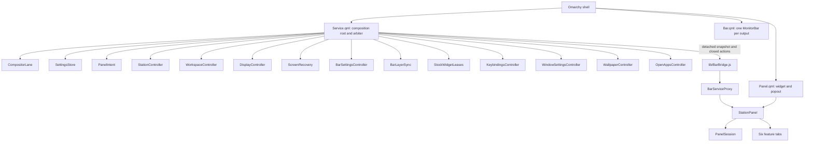

# Architecture

Station is a Quickshell plugin for Omarchy 4. It has one persistent service, a panel
per output, and pure JavaScript policy. It has no daemon, no binary and no network
access. This page explains how the code fits together. For required behavior, read
[Contracts](contracts.md).

## Overview

## Where things live

Runtime code is grouped by feature. A feature folder holds its pure policy, its
owner and its tab, so one change stays in one place.

| Path | Holds |
| --- | --- |
| `Service.qml` | Composition root. Operation state, event routing, startup order, IPC and the public panel surface. |
| `Panel.qml`, `Bar.qml` | Host entry points. They import the bridge from the top level (see [Bridge identity](#bridge-identity)). |
| `lib/BarBridge.js` | Bridge library. Pinned at this path because its URL is its identity. |
| `lib/stations/` | Workspace numbering, migrations, switching, window actions, open-app rows. |
| `lib/displays/` | Display identity and geometry, monitor Lua, previews, Keep, screen recovery, Displays tab. |
| `lib/bars/` | Per-monitor bar settings, layer rule, stock widget leases, Station's bar controls, Bar tab. |
| `lib/bars/omarchy/` | `MonitorBar.qml` and `BarModel.js`: attributed adaptations of Omarchy's bar. |
| `lib/windows/` | Window setting limits, Lua generation, save and read-back, Windows tab. |
| `lib/wallpaper/` | Crop geometry, profiles, staging helper, surfaces, Wallpaper tab. |
| `lib/keybindings/` | Bind table, conflict check, key picker, Keybindings tab. |
| `lib/panel/` | Panel frame and lifecycle, panel intent, bridge contract and proxies, Settings tab, shared controls. |
| `lib/platform/` | Compositor queues, config and state files, Lua generators, fixed shell templates, event matching. |
| `test/` | All checks. See [Testing](testing.md). |
| `assets/`, `docs/` | Artwork and this documentation. |

### Import rule

Each feature folder has its own QML qualifier: `Bars`, `OmarchyBar`, `Displays`,
`Keys`, `PanelUi`, `Platform`, `Stations`, `WallpaperUi` and `WindowsUi`. Do not share
one qualifier across folders. Quickshell's loader does not resolve that reliably, and
offscreen harnesses do not detect the failure. Only `test/lint/compile-qml.py` does.

## Owners

Each asynchronous protocol has one owner. The owner is a persistent child of
Service. It receives data bindings and finite ports, and it never receives the
Service object. Only that owner writes its private state.

| Owner | Owns | Main file state |
| --- | --- | --- |
| `CompositorLane` | Serial command queue, FIFO snapshot queue, observed monitors and clients | none |
| `SettingsStore` | Load gates and atomic writes for preferences and bookkeeping | `config.json`, `state.json` |
| `PanelIntent` | Panel intent, remembered tab and output, evacuation barrier | none (in memory) |
| `StationController` | Switching, queued switch target, window actions, follow focus | none |
| `WorkspaceController` | Migration journal, phases, retries, commit | `workspace-map.json` |
| `DisplayController` | Draft, preview, baseline, Keep and Revert, candidate files, countdown | `monitors.lua`, preview token |
| `ScreenRecovery` | Stale Wayland output check and one recovery cycle | none |
| `BarSettingsController` | Per-monitor rows, deferred host publication, measured limits | `config.bars`, shell config |
| `BarLayerSync` | Station's named bar layer rule and the runtime blur override | none |
| `WorkspaceAuthority` | Stops Omarchy renumbering workspaces | `toggles/hypr/station-workspaces.lua` |
| `StockWidgetLeases` | Hiding and restoring stock widgets | leases in `state.json` |
| `KeybindingsController` | Conflict check and bind application, once per generation | `appliedBinds` in `state.json` |
| `WindowSettingsController` | Explicit window edits, read-back, busy state | `looknfeel.lua` |
| `WallpaperController` | Draft, staging, profiles, desktop surfaces | `config.wallpaper`, private copies |
| `OpenAppsController` | Read-only client feed for the bar | none |

Service is deliberately not empty. Coordination between owners has to live
somewhere, and one arbiter makes that coupling visible. Service keeps:

- Operation state: `idle`, `applyingLayout`, `previewing`, `migrating`, `moving`,
  `switching` or `recoveringScreen`.
- `gen`, which retires stale callbacks, and `configGeneration`, which retires
  queued commands after a reload.
- `expect`, the record of events Station is about to cause.
- Routing of compositor events, startup order, IPC and lane assignment.

Pure policy lives in `.js` files with no QML dependency, so Node tests can load it
directly: `Grid`, `Model`, `MonitorsLua`, `Hypr`, `Binds`, `Store`, `Transactions`,
`Recovery`, `Events`, `Windows`, `WindowConfig`, `WindowPreview`, `Wallpaper`, `Tabs`,
`PanelPosition`, `OpenApps`, `ScreenHealth` and `ServiceContract`.

## Panel lifetime

The panel is a popout of a bar widget, and a bar rebuild destroys it. Therefore:

- `PanelIntent` on the service holds open intent, the selected output and the tab.
  A rebuilt widget reads them and reopens.
- `PanelSession` is widget-local. It holds retained screen and edge, reopen retries,
  and the 180 ms unmap acknowledgment. It receives a finite intent facade.
- `DisplayControls` is widget-local. It holds brightness and text-size requests.
- Each tab receives read-only tokens and a finite facade of the members it consumes.
  No tab receives the panel root.
- Monitor cards are Repeater delegates, so a model change can destroy a delegate
  during its own handler. Keep follow-up actions in a surviving object.

## Bridge paths

Omarchy's stock bar gives a widget the live service. A replacement bar gives no
service, and Station's own full bar is a replacement bar.

| Path | Panel reaches the service through |
| --- | --- |
| Direct | The live Service object. No polling. |
| Bridge | `BarServiceProxy` and `WallpaperProxy`, reading detached snapshots from `lib/BarBridge.js`. It polls every 150 ms with the panel open or app icons on, otherwise every 1 s. |

`lib/panel/ServiceContract.js` defines the snapshot shape and the closed action
allowlist. To add a panel member, change the contract, the proxies and
`test/unit/panel-bridge.test.cjs` together.

### Bridge identity

Quickshell loads a nested type's imports under a `qs:///` URL, and a top-level file's
imports under `file:///`. A `.pragma library` script has one instance per URL. So
`Panel.qml` imports the bridge beside `Service.qml` and passes a reader callback into
`StationPanel`. Do not import the bridge from a nested type, because that creates a
second library with no publisher.

Deferred hand-off work captures the bridge API and scalar values, never a proxy. A
bar rebuild can destroy the proxy first.

## Per-monitor bar

`Bar.qml` creates one `MonitorBar` per connected screen. Each receives a detached copy
of the shared layout with that connector's settings. `MonitorBar.qml` is an attributed
adaptation of Omarchy's bar, and [THIRD_PARTY_NOTICES.md](../THIRD_PARTY_NOTICES.md)
records its origin. It stays large on purpose (see
[Decisions](decisions.md#keep-the-adapted-bar-whole)).

While the panel is open, `config.bars` is the live authority, read through the bridge.
The service defers the shell config write until the panel closes, because that write
reloads the host config and can recreate the bar under an open panel.

## Files on disk

| Path | Owner | Content |
| --- | --- | --- |
| `~/.config/omarchy/station/config.json` | `SettingsStore` | Preferences, identities, lanes, binds, bars, wallpaper |
| `~/.local/state/omarchy/station/state.json` | `SettingsStore` | Last station, applied binds, leases, lifecycle flags |
| `~/.local/state/omarchy/station/workspace-map.json` | `WorkspaceController` | Committed map, pending journal, preview baseline |
| `~/.local/state/omarchy/station/preview.token` | `DisplayController` | Marks an active preview for the watchdog |
| `~/.local/state/omarchy/station/monitors-block.plain.lua` | `DisplayController` | Retained for older cleanup scripts ([why](decisions.md#keep-the-plain-geometry-copy)) |
| `~/.local/state/omarchy/station/wallpapers/` | `WallpaperController` | Private image copies |
| `~/.config/hypr/monitors.lua` | `DisplayController` | Marked block at the beginning. Station never changes other lines. |
| `~/.config/hypr/looknfeel.lua` | `WindowSettingsController` | Marked section at the beginning. Station never changes other lines. |

## How to add a feature

1. Put the policy in a pure `.js` file with Node tests.
2. Put asynchronous state in one owner. Give it data and finite ports.
3. Add it to `Service.qml`. Forward only the methods the panel or IPC consumes.
4. Add panel members to `ServiceContract.js`, the proxies and the bridge tests.
5. Write the behavior in [Contracts](contracts.md).
6. Run `python3 test/run.py all`.
